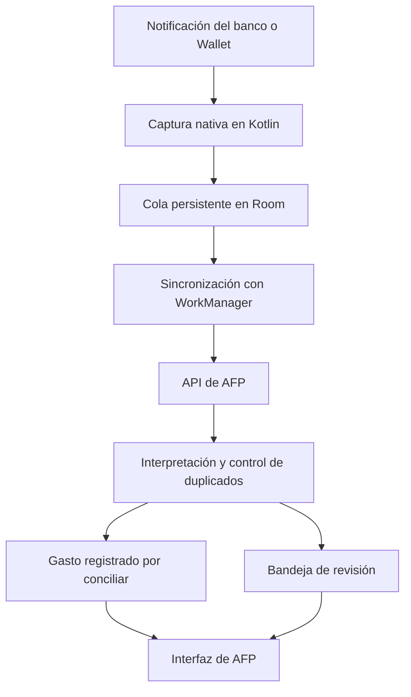

# AFP Android: plan por fases para capturar compras automáticamente

**Archivo:** `PLAN_CAPTURA_AUTOMATICA_ANDROID.md`, en la raíz del proyecto.\
**Estado:** Fase 1 con implementación terminada y validación real pendiente: APK 0.1.2 instalada, ocho fuentes verificadas y seleccionadas, nueve tarjetas inventariadas, batería Samsung revisada, TWA comprobada y Digital Asset Links publicado. Solo quedan las muestras bancarias reales, su anonimización revisada y la captura real con pantalla bloqueada. El usuario avisará al recibir un cargo. Fase 2 implementada y verificada con PostgreSQL local, cliente Kotlin y cuatro pruebas nuevas en el S24 Ultra; migración aplicada y verificada en Supabase con autorización; confirmación de la versión web publicada y actualización de la APK de producción pendientes. Fases 3–7 sin iniciar.\
**Dispositivo inicial:** Samsung S24 Ultra, Android 16 y One UI 8.5.\
**Cobertura prevista:** todas las tarjetas existentes en AFP, conservando sus identidades e historiales.\
**Primer piloto de registro automático:** BBVA Platinum; los demás bancos se preparan desde el diagnóstico y se activan gradualmente.

## 1. Objetivo y alcance

Desarrollar una APK propia de AFP que capture las notificaciones de compras, conserve los avisos pendientes y registre los gastos automáticamente.

El diseño y la recopilación de evidencia contemplarán todas las tarjetas desde la Fase 1. BBVA será el primer piloto para validar el registro automático y la conciliación; la preparación de las demás fuentes no se pospondrá hasta la Fase 7.

El funcionamiento diario dependerá de la aplicación Android y del servidor actual de AFP. No requerirá Codex, ChatGPT, Tasker, Automate, un lector de Gmail en la computadora ni una computadora encendida.

La interfaz actual se reutilizará mediante una **Trusted Web Activity —TWA—**, que utiliza un navegador Android compatible para mostrar AFP dentro de la APK. La captura y la sincronización serán componentes nativos independientes de esa pantalla. Se mantendrán Next.js, Prisma, Supabase y el alojamiento actual. [Documentación de TWA](https://developer.chrome.com/docs/android/trusted-web-activity/).

### Cobertura prevista

| Compra | Fuente principal para registrarla |
|---|---|
| Tarjeta física en una terminal | Aviso de cargo del banco. |
| Pago mediante Google Wallet | Aviso de Wallet o del banco, controlando duplicados. |
| Compra en una página web | Aviso bancario de la tarjeta utilizada. |
| Amazon | Cargo bancario; cada cargo parcial se tratará individualmente. |
| Mercado Libre y comercios que cobran mediante Mercado Pago | Cargo a la tarjeta identificada, conservando el descriptor bancario. |
| Suscripciones y otros comercios | Aviso bancario, con reglas específicas para vincular suscripciones existentes. |

La cobertura depende de la tarjeta y de los avisos disponibles, no de desarrollar una conexión con cada comercio. Un aviso de «pedido recibido», «envío realizado» o «entrega completada» no constituye evidencia suficiente para crear un gasto.

**Límite funcional:** AFP no puede detectar una operación si ninguna fuente genera un aviso accesible. Las notificaciones incompletas o protegidas requerirán revisión; los movimientos sin aviso se detectarán al conciliar el estado de cuenta. Android puede ocultar contenido sensible a los lectores de notificaciones. [Documentación de Android](https://developer.android.com/about/versions/15/behavior-changes-all#otp-redaction).

### Preparación de todas las tarjetas y activación gradual

- Inventariar las tarjetas existentes en AFP y sus aplicaciones emisoras. Una aplicación puede notificar compras de varias tarjetas; una tarjeta puede recibir avisos del banco y de Wallet. La captura se selecciona por aplicación y la resolución financiera se realiza por tarjeta.
- Recoger muestras de todas las fuentes autorizadas durante el diagnóstico. Antes de incorporar un paquete a la APK, verificar su identificador e instalación; no añadir identificadores supuestos ni habilitar aplicaciones nuevas automáticamente.
- Mantener separados los alias de cada tarjeta física, digital y token de Wallet. Dos tarjetas del mismo banco deben poder resolverse por separado; si la evidencia no permite distinguirlas, el aviso queda en revisión.
- Preparar los analizadores disponibles durante las Fases 2–5, conforme lleguen muestras verificadas. La vinculación, cola y API serán comunes a todas las fuentes; añadir un banco no requerirá rehacer ese flujo.
- Distinguir **diagnóstico** (comprobar los avisos accesibles), **observación** (interpretar y mostrar propuestas sin crear gastos) y **registro automático** (crear gastos solo para tarjetas y formatos validados). Pausar una aplicación detiene su captura; desactivar la automatización de una tarjeta conserva la observación de las otras.
- Mantener BBVA como primera activación automática. La habilitación posterior se controla por tarjeta y formato; validar una tarjeta no habilita todas las del mismo banco ni todos los avisos de Wallet.

La matriz de cobertura documentará paquetes, versiones, tarjetas previstas, muestras disponibles, alias pendientes y estado de habilitación. Una fuente sin aplicación instalada o sin muestras seguirá identificada como pendiente. Se puede avanzar en las Fases 2–5 mientras se completa el diagnóstico; esa fuente permanecerá fuera del registro automático y sus tareas sin concluir seguirán sin marcar.

## 2. Arquitectura y contratos

### Componentes

| Componente | Tecnología y responsabilidad |
|---|---|
| Aplicación Android | Kotlin, Android SDK y Gradle; proyecto dentro de `android/`. |
| Configuración del teléfono | Jetpack Compose para permisos, vinculación, pendientes y diagnóstico. |
| Captura | `NotificationListenerService`, filtrando las aplicaciones autorizadas. |
| Persistencia local | Room para guardar eventos antes de intentar enviarlos. |
| Sincronización | WorkManager para ejecutar envíos y reintentos con conexión disponible. |
| Credenciales | Cifradas con claves protegidas por Android Keystore. |
| Interfaz financiera | AFP actual mediante TWA; componentes shadcn existentes. |
| Interpretación y registro | Reglas deterministas en el servidor de AFP, sin modelos de IA. |

[Room](https://developer.android.com/training/data-storage/room) proporciona persistencia local y [WorkManager](https://developer.android.com/develop/background-work/background-tasks/persistent) permite mantener trabajos pendientes a través de reinicios de la aplicación y del dispositivo, respetando las restricciones de Android.

### Datos e interfaces

- Añadir persistencia para **dispositivos vinculados, vinculaciones temporales, eventos recibidos, movimientos importados, alias de tarjetas y reglas de clasificación**.
- Diseñar desde el inicio un catálogo de fuentes y analizadores por banco/formato, vinculado con las tarjetas existentes. La configuración distinguirá la autorización de la aplicación emisora de la habilitación automática por tarjeta y formato; el estado inicial será diagnóstico u observación.
- Cada movimiento podrá reunir varios eventos y vincularse con un gasto o una compra a meses. Conservar su identidad aunque se elimine el registro financiero.
- Incorporar `POST /api/captures/events`, autenticado mediante una credencial revocable del dispositivo. El usuario procederá de esa credencial.
- El evento tendrá versión de contrato, UUID persistente, aplicación de origen, identificador de notificación, fechas de publicación y recepción, y texto necesario para interpretarlo.
- Añadir endpoints bajo `/api/captures` para vinculación, configuración y revisión. Las operaciones administrativas exigirán la sesión Supabase actual.
- El servidor confirmará la recepción únicamente después de persistir el evento. Reenviar el mismo UUID y contenido devolverá el resultado existente; cambiar su contenido producirá un conflicto.
- Extraer la creación de gastos a un servicio que acepte una transacción Prisma existente. Reutilizar las validaciones financieras y conservar el contrato y la idempotencia de `/api/expenses`.
- Las migraciones serán aditivas, con RLS explícito. Los registros históricos mantendrán su comportamiento actual.

## 3. Fases de implementación

Cada fase se cerrará con sus pruebas y evidencia registradas en este documento. Las casillas marcadas representan actividades concluidas; una fase permanece abierta hasta satisfacer su criterio de salida.

### Fase 1. APK propia y validación de las notificaciones

**Objetivo:** comprobar la captura en el teléfono real y preparar el diagnóstico de todas las tarjetas antes de automatizar escrituras financieras.

- [x] Crear el proyecto Android con Kotlin, Compose, variantes de desarrollo y producción, y firma propia.
- [x] Integrar la interfaz web mediante TWA, con origen y apertura de AFP declarados en la APK y archivo Digital Asset Links preparado con el certificado real de producción.
- [x] Publicar Digital Asset Links con autorización y verificar por HTTPS el certificado de la APK; comprobar el dominio como `verified` en el S24 Ultra.
- [x] Comprobar visualmente que AFP abre como TWA sin la barra de direcciones del navegador; confirmado por el usuario en el S24 Ultra con la APK 0.1.1.
- [x] Implementar la pantalla de activación y el permiso especial de **acceso a notificaciones**. Distinguirlo del permiso para mostrar notificaciones propias.
- [x] Conceder manualmente el acceso a AFP y comprobar el diagnóstico activo con el lector conectado en el S24 Ultra.
- [x] Crear el lector nativo en modo diagnóstico, limitado inicialmente a BBVA y Google Wallet. Verificar los identificadores reales de ambas aplicaciones.
- [x] Inventariar todas las tarjetas actuales de AFP, las aplicaciones que emiten sus avisos y los casos de varias tarjetas en una misma aplicación. Contrastar el inventario inicial del README con la configuración vigente.
- [x] Verificar identificadores y versiones de las demás aplicaciones bancarias instaladas; registrar las ausentes o sin avisos accesibles como limitaciones pendientes.
- [x] Ampliar el lector y la selección de fuentes de la APK al catálogo verificado, con selección explícita de cada fuente y sin habilitar escrituras financieras.
- [ ] Obtener muestras de los formatos disponibles de todas las fuentes autorizadas y preparar versiones anonimizadas para pruebas. Identificar importe, moneda, comercio, fecha, tarjeta y referencia; distinguir campos ausentes y avisos que no permiten identificar cuál de varias tarjetas se usó.
- [x] Preparar la matriz de fuentes/campos, las pruebas sintéticas y la exportación de estructura anonimizada, sin atribuirles cobertura bancaria real.
- [x] Incorporar instrucciones de activación, ajustes restringidos, batería Samsung y comprobación con pantalla bloqueada dentro de AFP. [Gestión de aplicaciones de Samsung](https://developer.samsung.com/mobile/app-management.html).
- [x] Comprobar las rutas y restricciones de batería de Samsung en el S24 Ultra: aplicar «No restringido», verificar la exención por Android y revisar las listas de suspensión/suspensión profunda/sin autosuspensión.
- [ ] Probar captura real con pantalla bloqueada en el S24 Ultra; esperar un aviso nuevo del piloto con el diagnóstico activo, sin generar compras solo para probar.

**Criterio de salida:** la APK abre AFP y admite el catálogo verificado de aplicaciones seleccionadas en el S24 Ultra; existe un inventario de todas las tarjetas y una matriz que distingue formatos comprobados, fuentes sin muestras y limitaciones observadas. La captura del piloto tiene evidencia real y cada fuente adicional conserva su estado comprobado o pendiente. Todavía no crea gastos; una casilla pendiente no se cierra por tener preparada su estructura.

**Seguimiento · 20–21 de octubre de 2026 · fase abierta:**

- Proyecto en `android/`: Gradle 9.3.1, AGP 9.1.1/Kotlin 2.2.10, Compose, SDK de compilación 37 y objetivo 36. Se generaron ambas APK con firmas propias separadas. Claves y configuración privadas excluidas de Git; deben respaldarse antes de distribuir actualizaciones. La APK de producción supera `apksigner verify` y su certificado coincide con `public/.well-known/assetlinks.json`.
- Diagnóstico pausado por defecto; selección explícita de fuentes, estado del permiso y conexión del lector, reconexión y exclusión de resúmenes agrupados. Hasta 100 muestras locales cifradas con AES-GCM/Android Keystore, escritura atómica y exclusión de copias de seguridad. El texto original solo se revela en el teléfono; no se envían eventos ni se escriben gastos. Room y sincronización continúan pendientes de sus fases.
- S24 Ultra conectado y verificado por ADB: Samsung `SM-S928B`, Android 16/API 36, One UI `80500` (8.5); BBVA `com.bancomer.mbanking` versión `26.90.14` y Wallet `com.google.android.apps.walletnfcrel` versión `26.40.996156910`, instalados. Estas comprobaciones no leen el historial ni acreditan los formatos de compra.
- Validación Android inicial (20 de octubre): **6 pruebas unitarias y 7 instrumentadas correctas en el S24 Ultra**, con notificaciones sintéticas. Cubren filtros/pausa/anonimización, extracción de texto ampliado, cifrado, reapertura, límite del búfer, borrado, rechazo de alteraciones y componentes auxiliares de TWA. Compilaciones `debug`/`release` y lint correctos; lint conserva cinco avisos sobre objetivo Android 16 y versiones posteriores disponibles de Gradle/Compose/Activity/Lifecycle. No se suprimieron comprobaciones.
- Validación web: **214 casos, 207 correctos y 7 integraciones omitidas sin `AFP_TEST_DATABASE_URL`, cero fallos**. `pnpm exec next build --webpack` correcto; lint sin errores y con la advertencia previa de TanStack Table. Digital Asset Links responde **HTTP 200 y `application/json`** tanto localmente como en producción, sin redirecciones, con el certificado esperado.
- **Despliegue autorizado y concluido:** Vercel `afp`, entorno de producción, despliegue `dpl_3ydQbyNmuVbf8g2nWPAJgEJz4Bnk`, estado `READY`. La base `505b47e` coincide con la versión previamente publicada; el cambio web añadido es `public/.well-known/assetlinks.json`. Se enviaron 196 archivos de la web y configuración de compilación; las claves y datos Android permanecieron locales. `/login`, `/dashboard`, `/gastos` y el manifest responden 200; las API de Gastos/Tarjetas sin sesión responden 401. No se aplicaron migraciones ni se modificó Supabase. La consulta inmediata de logs de errores/fallos del nuevo despliegue no devolvió grupos; no acredita todos los flujos financieros autenticados.
- Incidencia de permiso resuelta: el usuario reportó bloqueo por ajustes restringidos y habilitó manualmente el acceso. La consulta posterior confirmó el permiso de producción; AFP muestra **«Lector conectado; esperando avisos nuevos»**, que confirma diagnóstico activo. El permiso no se concedió por ADB. Android volvió a verificar `finanzas.garatachia.com` con resultado **`verified`**.
- Incidencia de apertura resuelta en **APK 0.1.1, versionCode 2**: faltaba declarar `ManageDataLauncherActivity`, utilizada por Browser Helper al abrir AFP. Se declararon esa actividad y `FocusActivity` como internas y se añadió una regresión que ejecuta la gestión real del componente auxiliar. Se instaló la actualización con la misma firma; se conservaron el acceso y el servicio de captura. ADB confirmó Chrome `141.0.7390.43` con la actividad de TWA y sin barra del navegador; el usuario confirmó que AFP abre correctamente. Restaban avisos reales y pruebas de bloqueo/batería; la batería y ampliación a ocho fuentes se comprobaron el 21 de octubre, según el seguimiento siguiente. Las muestras reales y la captura con pantalla bloqueada continúan pendientes.

Evidencia agregada sin números de serie, credenciales ni textos bancarios: [verificación](artifacts/android-fase1/verification.json) y [despliegue autorizado](artifacts/android-fase1/deployment.json). Procedimientos y límites: [guía Android](docs/android-captura.md). Cobertura comprobada y pendiente: [matriz de formatos](android/diagnostics/format-matrix.md).

**Ajuste de alcance implementado · 21 de octubre de 2026:**

- Inventario vigente de **9 tarjetas** confirmado mediante transacción de solo lectura y consulta exclusiva de nombres: BBVA, HSBC 1/2, BANAMEX 1/2, SANTANDER, NU, DIDI y MERCADOPAGO. No se alteraron identidades, productos ni movimientos. Las dos tarjetas de HSBC y Banamex quedan separadas; sus alias y las tarjetas inscritas en Wallet siguen pendientes de evidencia.
- **Ocho aplicaciones instaladas y verificadas**: BBVA, Wallet, HSBC, Banamex, Santander, Nu, DiDi Finanzas y Mercado Pago. La matriz registra sus paquetes, versiones y fichas oficiales. La app DiDi de viajes permanece fuera del catálogo hasta verificar si es necesaria como emisora de avisos de tarjeta.
- **APK 0.1.2 / versionCode 3 instalada** con la firma existente. Antes de seleccionar las nuevas fuentes, la pantalla mostró `8/8 instaladas · 2 seleccionadas e instaladas`, acreditando que la actualización no las habilitó. Después se pulsó explícitamente «Seleccionar todas las instaladas»: quedaron las ocho seleccionadas para el diagnóstico solicitado. Se conservaron el permiso, la activación y la conexión del lector.
- Catálogo cerrado de ocho paquetes, interruptores individuales, versiones por perfil y contadores por fuente/bloqueo. Las preferencias desconocidas se descartan y una selección vacía se conserva. El script de comprobación lee los paquetes del manifest; una regresión evita divergencias con el lector y prohíbe visibilidad global de aplicaciones.
- **9 pruebas unitarias, 10 instrumentadas en el S24 Ultra y 3 regresiones Node correctas**. Las pruebas adicionales cubren selección explícita de cada fuente, actualización desde preferencias anteriores/ausentes/vacías, extracción y persistencia separada de las ocho identidades y texto ausente. Son sintéticas; no acreditan compra real ni entrega del servicio con bloqueo. Compilaciones debug/release y lint correctos; se mantienen los cinco avisos de versiones/objetivo previamente documentados.
- Apertura repetida corregida: Browser Helper relanzaba la actividad sin `NEW_TASK` y podía dejar el diagnóstico al frente. El botón utiliza `NEW_TASK | CLEAR_TOP`; una regresión de accesibilidad abre AFP, vuelve al diagnóstico conservando la TWA existente y la abre otra vez. La prueba reprodujo el fallo antes de la corrección y después pasó en el S24 Ultra. La verificación de confianza del dominio sigue siendo independiente y no se desactiva.
- Batería comprobada físicamente: **Ajustes → Aplicaciones → AFP → Batería → No restringido**. Android pasó de no exenta/bucket `10` a exenta/bucket `5`, con `RUN_ANY_IN_BACKGROUND: allow`. En **Ajustes → Batería → Límites de uso en segundo plano**, Aplicaciones suspendidas estaba vacía, AFP no aparecía en suspensión profunda tras recorrer la lista completa y Aplicaciones sin autosuspensión estaba vacía. No se cambiaron ajustes globales ni otras aplicaciones. La pantalla nativa muestra el estado de Android al regresar de Ajustes; esta preparación no sustituye una prueba de entrega con bloqueo.
- Continúan pendientes únicamente la recopilación/revisión de avisos bancarios reales, las copias anonimizadas útiles para analizadores y la captura real del piloto con pantalla bloqueada. El usuario confirmó que avisará al recibir un cargo nuevo. Ningún campo se declaró presente o ausente sin observarlo; tampoco se creó un gasto. La Fase 1 conserva su estado abierto por ese criterio de salida.

Evidencia de esta ampliación: [verificación de ocho fuentes](artifacts/android-fase1/multi-source-verification.json). La evidencia de 0.1.1 y su despliegue web se conserva como historial. Esta actualización solo modifica la APK y documentación; no necesita otro despliegue ni cambios de BD. La Fase 7 concentra la activación automática gradual de las fuentes preparadas.

### Fase 2. Vinculación del teléfono y recepción segura

**Objetivo:** conectar el componente nativo con la cuenta personal de AFP.

- [x] Crear los modelos y endpoints de dispositivos, vinculaciones y eventos.
- [x] Implementar una vinculación de un solo uso: el teléfono genera su secreto, el servidor conserva su hash y presenta un código temporal; el usuario autoriza ese código desde AFP con su sesión Supabase.
- [x] Hacer que el código expire a los cinco minutos y limitar los intentos. La autorización quedará asociada al dispositivo que inició el proceso.
- [x] Limitar la credencial del dispositivo al envío de eventos y consulta de su configuración y estado. Permitir revocarla desde AFP.
- [x] Separar esta autorización de la sesión web: cerrar la pantalla o vencer la sesión del navegador no interrumpirá la captura. Pausar o desvincular el dispositivo será una acción explícita.
- [x] Mantener cada pendiente asociado a su propietario original; nunca trasladarlo automáticamente a otra cuenta.

La TWA no permite al componente nativo leer directamente las cookies o el almacenamiento de la web. La vinculación evita depender de ese acceso. [Documentación de TWA](https://developer.chrome.com/docs/android/trusted-web-activity/).

**Criterio de salida:** un dispositivo autorizado puede enviar eventos; uno pendiente o revocado no puede registrar movimientos ni consultar datos financieros ajenos.

**Implementación concluida y criterio de salida verificado · 21 de octubre de 2026.**

- Se añadieron `CaptureDevice`, `CapturePairing`, `CaptureEvent` y `CaptureRateLimit`, y los endpoints `/api/captures/pairings`, `/devices`, `/device` y `/events`. La migración `20261021000000_add_android_capture_linking` es aditiva, con RLS explícito sin políticas públicas, propietario inmutable y relación compuesta para conservar la pertenencia de los eventos. No crea ni modifica gastos.
- La APK 0.2.0 / versionCode 4 genera y persiste el secreto antes de la petición. Conserva credenciales e identidades anteriores cifradas con Keystore y fuera de copias de seguridad. Recupera el inicio después de una respuesta perdida, sin prolongar el código. La web autoriza el código con sesión Supabase y permite pausar, reanudar y revocar los dispositivos propios. El teléfono consulta estado/configuración y permite pausar/reanudar o desvincular su propia identidad.
- La autorización dura independientemente de la sesión del navegador. Pendientes, vencidos, pausados y revocados no pueden entregar eventos; la credencial tampoco accede a las API financieras. Los eventos se guardan y confirman transaccionalmente, con recibo repetible por dispositivo/UUID y conflicto de contenido. Revocar y recibir se serializan sobre la misma fila.
- **234 regresiones web correctas, cero fallos y cero omisiones**, con PostgreSQL 16 local, Auth ficticia y datos sintéticos. Se verificaron expiración, límites persistentes, dos cuentas, autorizaciones y envíos concurrentes, rollback, respuesta perdida, cierre de sesión y revocación concurrente. La reconstrucción prueba las 18 migraciones, actualización histórica, checksums, diff vacío, datos preservados y 21 tablas con RLS.
- **14 pruebas Kotlin/JVM y cuatro instrumentadas nuevas correctas en el S24 Ultra (Android 16/API 36)**. Las instrumentadas comprueban cifrado/reapertura real, rechazo de alteraciones, identidades/propietarios conservados y entrega completa por HTTPS a la API/PostgreSQL locales. Incluyen rechazo antes de autorizar, recibo repetido, conflicto, pausa, reanudación y revocación. Build web, ambas APK firmadas y lint correctos, con los avisos previos documentados. La firma de producción coincide con Digital Asset Links.
- La comprobación en Chromium usa componentes y API reales con la cuenta ficticia de la base local. La documentación separa la recepción segura de las fases siguientes: el lector continúa guardando diagnóstico local; no hay todavía cola Room/WorkManager ni interpretación o creación automática de gastos. Los pendientes de esa futura cola deberán conservar siempre el propietario y la identidad originales.
- **Migración aplicada a producción con autorización · 21 de octubre de 2026, 07:10 UTC:** se respaldaron datos y metadatos en `estados_cuenta/android_fase2_2026-10-21-lfHFCZ/`, excluido de Git, y se aplicó únicamente `20261021000000_add_android_capture_linking` mediante `prisma migrate deploy`. Se regeneró Prisma y se verificaron 18 migraciones, checksums coincidentes, cero pendientes, diff vacío, 21 tablas con RLS y las cuatro nuevas vacías y sin políticas públicas. Se conservaron filas financieras, historial, estructura, permisos, RLS y automatización anteriores. No se insertaron registros de prueba en producción. El MCP requería renovar OAuth; se usó la conexión Prisma del proyecto. [Evidencia de aplicación](artifacts/android-fase2/produccion.json).
- **Confirmación de publicación web y APK de producción pendientes:** esta operación no hizo commit, push, despliegue ni actualización de la APK de producción. El usuario gestiona Git; durante el cierre se observó el commit `f084cc4`, alineación local con `origin/master` y respuesta 401 sin credencial de `/api/captures/devices` en el dominio público. No se verificó la identidad exacta del despliegue ni el flujo autenticado de producción. La documentación y evidencia de aplicación añadidas después del commit deben publicarse también. Las pruebas instalaron únicamente desarrollo y se comprobó que la APK de producción y su permiso de notificaciones permanecen. Tras el push se debe verificar la publicación web y después actualizar la APK firmada y vincular el teléfono. La Fase 1 conserva sus muestras bancarias reales pendientes.

Evidencia agregada sin secretos, códigos temporales, textos bancarios ni identificadores del teléfono: [verificación de Fase 2](artifacts/android-fase2/verification.json). Contrato, límites y repetición de pruebas: [guía Android](docs/android-captura.md#vinculación-y-recepción-segura--fase-2).

### Fase 3. Cola local y sincronización resistente a fallos

**Objetivo:** conservar los avisos capturados y entregarlos sin duplicarlos.

- [ ] Guardar cada evento en Room antes de iniciar cualquier petición. Mantener su UUID durante todos los reintentos.
- [ ] Filtrar localmente las aplicaciones autorizadas y excluir promociones, códigos de acceso y resúmenes de notificaciones agrupadas.
- [ ] Proteger el texto financiero almacenado localmente y excluir credenciales y pendientes de copias de seguridad automáticas.
- [ ] Implementar el envío mediante WorkManager con restricción de conexión y reintentos progresivos.
- [ ] Conservar pendientes ante respuestas perdidas y errores temporales; pausar envíos ante credenciales inválidas y mostrar errores permanentes para revisión.
- [ ] Recuperar la cola tras reinicios. Al reconectar el lector, inspeccionar únicamente las notificaciones todavía activas, sin presentarlas como un historial completo.
- [ ] Mostrar cantidad de pendientes, último envío confirmado, errores y acciones para reintentar o pausar.

**Criterio de salida:** desconectar Internet, reiniciar el teléfono o perder una respuesta del servidor no pierde eventos ya guardados ni genera gastos duplicados.

### Fase 4. Interpretación y registro financiero automático

**Objetivo:** convertir avisos admitidos en gastos correctos.

- [ ] Implementar el registro de analizadores deterministas y versionados por banco y formato, empezando por BBVA/Wallet e incorporando las demás fuentes conforme tengan muestras verificadas. Un formato desconocido quedará en revisión.
- [ ] Configurar los alias de tarjeta física, digital y token de Wallet para todas las tarjetas inventariadas, vinculándolos con sus IDs existentes en AFP. Resolver por separado las tarjetas de un mismo banco; los alias ausentes o ambiguos impiden el registro automático de ese aviso.
- [ ] Mantener el estado de observación/automatización por tarjeta y formato. Incorporar un analizador o identificar una aplicación no habilitará automáticamente todas sus tarjetas.
- [ ] Separar fecha de operación y recepción, usando `America/Mexico_City`. Mantener importes decimales exactos.
- [ ] Crear automáticamente un gasto cuando se identifiquen compra aprobada, tarjeta, importe, moneda y fecha sin ambigüedad. La primera versión automatizará MXN.
- [ ] Aplicar reglas de comercio a categoría; utilizar **«Por clasificar»** cuando falte una regla.
- [ ] Registrar el gasto como **«Por conciliar»** e incluirlo inmediatamente en gastos y estimaciones de cortes. No acreditarlo como consumo bancario confirmado para exención de comisiones.
- [ ] Guardar evento, resolución y gasto mediante una transacción, reutilizando los bloqueos y validaciones existentes.

**Reglas de duplicados y movimientos especiales:**

- Deduplicar reintentos mediante la identidad persistente del evento. Un importe, comercio y fecha iguales no serán una clave única.
- Vincular automáticamente avisos de distintos canales solo cuando exista una referencia inequívoca. Las coincidencias aproximadas quedarán en revisión antes de crear un segundo gasto.
- Comparar también con registros manuales y movimientos eliminados. Ofrecer «Vincular al existente» o «Es otra compra».
- Tratar actualizaciones de una notificación como posibles revisiones del aviso, sin asumir que cada actualización es una compra.
- Vincular suscripciones mediante reglas explícitas y reutilizar la unicidad por suscripción y mes.
- Enviar MSI, preautorizaciones identificables, devoluciones, cancelaciones, abonos y monedas distintas a revisión.
- Una conversión de gasto a MSI deberá sustituir el registro anterior en una transacción, evitando sumar el importe completo y las mensualidades simultáneamente.
- Conservar las correcciones del usuario. No inferir personas, aportaciones de efectivo ni cuentas por cobrar.

**Criterio de salida:** los casos admitidos se registran correctamente; los ambiguos permanecen visibles y no alteran los totales hasta resolverse.

### Fase 5. Revisión y conciliación desde AFP

**Objetivo:** resolver excepciones usando exclusivamente la aplicación.

- [ ] Añadir «Captura automática» en Configuración, con dispositivos, fuentes, tarjetas, alias, reglas y estado reportado. Permitir pausar cada aplicación y habilitar la automatización por tarjeta/formato, mostrando cuáles siguen en diagnóstico u observación.
- [ ] Incorporar una bandeja con estados **Por revisar, Registrado, Conciliado y Descartado**.
- [ ] Permitir corregir tarjeta, fecha, importe y categoría; vincular evidencias; confirmar compras distintas; descartar avisos y convertir compras a MSI.
- [ ] Mostrar origen y estado de conciliación en las vistas financieras pertinentes, incluida la información disponible sin conexión.
- [ ] Actualizar los datos al recuperar el foco y consultar novedades cada treinta segundos mientras la bandeja esté visible.
- [ ] Incorporar conciliación manual contra el estado de cuenta: seleccionar tarjeta y período, confirmar movimientos individualmente, registrar faltantes y explicar diferencias. Esta versión no dependerá de un importador automático de PDF.
- [ ] Mantener la multiplicidad de cargos iguales y las modificaciones personales. La ausencia de un movimiento en un estado de cuenta no lo cancelará automáticamente.

**Criterio de salida:** todos los errores y excepciones habituales pueden resolverse desde AFP, sin scripts ni intervención de Codex.

### Fase 6. Piloto completo con BBVA Platinum

**Objetivo:** comprobar el primer registro automático completo con el uso real, mientras las demás fuentes continúan en diagnóstico u observación.

- [ ] Ejecutar inicialmente en **modo observación**: recibir, interpretar y mostrar propuestas, sin crear gastos automáticamente.
- [ ] Mantener la recopilación y observación de las demás fuentes preparadas desde la Fase 1; su registro automático permanecerá desactivado hasta validar cada tarjeta y formato.
- [ ] Validar compras presenciales, en línea y mediante Wallet; incluir avisos disponibles de Amazon y Mercado Libre. Registrar los canales que todavía no tengan muestras verificadas.
- [ ] Completar las pruebas de fallo y los controles financieros antes de activar el registro automático.
- [ ] Preparar las migraciones, respaldo, despliegue y APK firmada. Aplicar los cambios de producción después de la autorización explícita exigida por el proyecto.
- [ ] Activar el registro automático únicamente para los formatos comprobados de BBVA.
- [ ] Observar un período que incluya un corte completo y conciliarlo. Medir compras capturadas, movimientos sin aviso, duplicados, revisiones y errores de interpretación.
- [ ] Verificar que actualizar la APK conserve permisos aplicables, configuración y pendientes.

**Criterio de salida:** no existen pérdidas atribuibles a la cola ni duplicados causados por reintentos; las diferencias del corte están identificadas y resueltas. La cobertura real queda documentada, sin atribuir a la app operaciones para las que no recibió una señal.

### Fase 7. Activación gradual de las demás tarjetas

**Objetivo:** habilitar y comprobar el registro automático de las tarjetas preparadas desde las fases anteriores, reutilizando el flujo común validado en el piloto.

- [ ] Completar las muestras, analizadores versionados y alias que sigan pendientes para cada tarjeta. Reutilizar el inventario y la evidencia recogidos desde la Fase 1; un banco sin evidencia suficiente permanecerá en diagnóstico u observación.
- [ ] Verificar resultados en observación y activar gradualmente por tarjeta y formato. Una validación de banco o de Wallet no habilitará automáticamente las demás tarjetas.
- [ ] Repetir los escenarios de comercios físicos, compras en línea, Wallet, cargos parciales y suscripciones.
- [ ] Actualizar README, guía de instalación y este documento con la cobertura comprobada de cada fuente.
- [ ] Mantener la posibilidad de pausar una fuente o regresar a observación sin borrar información.

**Criterio de salida:** cada tarjeta habilitada tiene cobertura documentada, pruebas propias y un procedimiento de recuperación.

## 4. Pruebas y aceptación

| Escenario | Resultado requerido |
|---|---|
| Mismo evento reenviado varias veces o concurrentemente | Un único procesamiento financiero. |
| Avisos del banco y Wallet para la misma compra | Un gasto; vinculación segura o evidencia pendiente de revisión. |
| Dos compras legítimas iguales | Se conserva su multiplicidad; ninguna desaparece por una comparación aproximada. |
| Dos tarjetas del mismo banco o distintas tarjetas en Wallet | Cada aviso se vincula con la tarjeta correcta mediante evidencia; una identidad ambigua queda en revisión. |
| Banco conocido con una tarjeta o formato aún no habilitados | Permanece en observación o revisión y no crea un gasto automáticamente. |
| Se pausa una aplicación o se desactiva la automatización de una tarjeta | La captura de esa aplicación o el registro automático de esa tarjeta se detienen según la acción; las demás conservan su configuración. |
| Compra manual seguida de aviso automático, o viceversa | Coincidencia identificada y resolución explícita sin duplicación silenciosa. |
| Pedido dividido en varios cargos | Se registran los cargos efectivos, sin añadir también el total del pedido. |
| Aviso de envío, promoción, rechazo o código de acceso | No crea un gasto. |
| Reinicio, ausencia de red y respuesta perdida | Los eventos guardados permanecen y pueden entregarse una sola vez. |
| Permiso revocado, aplicación detenida o restricción de Samsung | Estado visible al comprobarlo; sin afirmar que se capturaron avisos inaccesibles. |
| Cambio de formato o tarjeta desconocida | Revisión, sin inventar datos. |
| Suscripción, MSI, devolución y gasto compartido | Se preservan las reglas y los cálculos existentes. |
| Edición o eliminación posterior del gasto | Reprocesar un evento no deshace la corrección ni recrea el gasto. |
| Revocación de dispositivo y cambio de cuenta | Se detienen envíos no autorizados y se conserva la separación de propietarios. |

La verificación técnica incluirá:

- Pruebas unitarias de Kotlin, persistencia Room y sincronización.
- Pruebas de analizadores con muestras anonimizadas.
- Integración transaccional con PostgreSQL desechable, incluida concurrencia.
- Regresiones de gastos, suscripciones, ciclos, aportaciones y consumo mínimo.
- Pruebas de navegador y pruebas instrumentadas en el S24 Ultra.
- Lint, compilación Android, compilación web y reconstrucción de migraciones.

## 5. Decisiones y condiciones de cierre

- La solución será personal y Android; la captura será nativa y la interfaz financiera continuará siendo web.
- El servidor actual seguirá siendo necesario para completar registros y sincronizar datos. Sin conexión, se conservarán los avisos capturados en el teléfono.
- Todas las tarjetas se contemplan desde el diagnóstico. BBVA Platinum será el primer piloto automático; se conservarán los IDs, historiales y condiciones de todas las tarjetas existentes.
- La ampliación de la captura y la habilitación del registro automático son pasos separados. La validación y activación se documentan por tarjeta y formato; los casos sin evidencia suficiente permanecen pendientes.
- La automatización utilizará reglas comprobables. No enviará notificaciones a modelos de IA.
- Los datos personales y credenciales permanecerán fuera de Git y de los registros de diagnóstico.
- La captura comenzará desde su activación. No se supondrá acceso al historial de notificaciones ya desaparecidas.
- Una fase solo se marcará terminada cuando cumpla sus criterios de salida. El documento registrará fecha, validaciones, incidencias y cobertura pendiente.
