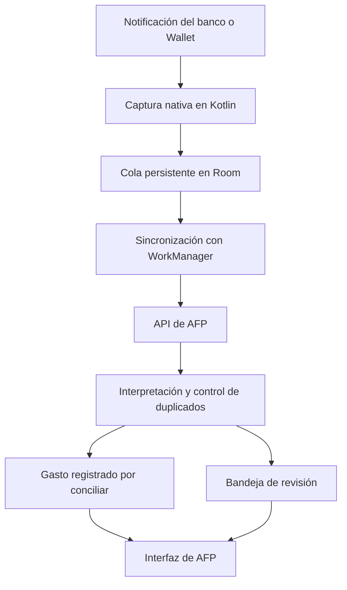

# AFP Android: plan por fases para capturar compras automáticamente

**Archivo:** `PLAN_CAPTURA_AUTOMATICA_ANDROID.md`, en la raíz del proyecto.\
**Estado:** Fases 2, 3 y 5 concluidas. Fases 1, 4, 6 y 7 conservan pendientes de cobertura real y conciliación de un corte completo. Fase 7: controles implementados y primer formato real Wallet/BANAMEX 1 validado; compra inicial registrada una vez y dos evidencias vinculadas mediante revisión explícita. Wallet/BANAMEX 1 y Nu/CFE tienen configuración automática preparada por formato. Nu/CFE usa la regla expresa de tarjeta NU, MXN, fecha del aviso y suscripción CFE; su cobro de octubre quedó confirmado sin cambiar la recurrencia habitual. **Falta publicar el código web para que opere sobre avisos nuevos.** Supabase tiene 26 migraciones, sin pendientes; APK personal 0.5.0 / versionCode 7 sin cambios. Verificación final: 440 pruebas web correctas, cero omisiones, lint y build correctos; reconstrucción y actualización de las 26 migraciones verificadas. Las tres actividades generales de cobertura/activación/canales de Fase 7 permanecen abiertas para el resto.\
**Dispositivo inicial:** Samsung S24 Ultra, Android 16 y One UI 8.5.\
**Cobertura prevista:** todas las tarjetas existentes en AFP, conservando sus identidades e historiales.\
**Pilotos:** BBVA Platinum continúa pendiente de aviso de crédito. La primera configuración automática preparada es BANAMEX 1 por Wallet, por disponer de evidencia real suficiente y política de fecha aceptada.

## 1. Objetivo y alcance

Desarrollar una APK propia de AFP que capture las notificaciones de compras, conserve los avisos pendientes y registre los gastos automáticamente.

El diseño y la recopilación de evidencia contemplarán todas las tarjetas desde la Fase 1. BBVA fue el primer piloto previsto; al no disponer de aviso de crédito, se avanza con BANAMEX 1 por Wallet, con evidencia propia. La preparación de las demás fuentes continúa en paralelo.

El funcionamiento diario dependerá de la aplicación Android y del servidor actual de AFP. No requerirá Codex, ChatGPT, Tasker, Automate, un lector de Gmail en la computadora ni una computadora encendida.

La interfaz actual se reutilizará mediante una **Trusted Web Activity —TWA—**, que utiliza un navegador Android compatible para mostrar AFP dentro de la APK. La captura y la sincronización serán componentes nativos independientes de esa pantalla. Se mantendrán Next.js, Prisma, Supabase y el alojamiento actual. [Documentación de TWA](https://developer.chrome.com/docs/android/trusted-web-activity/).

### Cobertura prevista

| Compra | Fuente principal para registrarla |
|---|---|
| Tarjeta física en una terminal | Aviso de cargo del banco. |
| Pago mediante Google Wallet | Aviso de Wallet o del banco, controlando duplicados. |
| Compra en una página web | Aviso bancario de la tarjeta utilizada. |
| Amazon | Cargo bancario; cada cargo parcial se tratará individualmente. |
| Mercado Libre y comercios que cobran mediante Mercado Pago | Cargo a la tarjeta identificada, conservando el descriptor bancario. |
| Suscripciones y otros comercios | Aviso bancario, con reglas específicas para vincular suscripciones existentes. |

La cobertura depende de la tarjeta y de los avisos disponibles, no de desarrollar una conexión con cada comercio. Un aviso de «pedido recibido», «envío realizado» o «entrega completada» no constituye evidencia suficiente para crear un gasto.

**Límite funcional:** AFP no puede detectar una operación si ninguna fuente genera un aviso accesible. Las notificaciones incompletas o protegidas requerirán revisión; los movimientos sin aviso se detectarán al conciliar el estado de cuenta. Android puede ocultar contenido sensible a los lectores de notificaciones. [Documentación de Android](https://developer.android.com/about/versions/15/behavior-changes-all#otp-redaction).

### Preparación de todas las tarjetas y activación gradual

- Inventariar las tarjetas existentes en AFP y sus aplicaciones emisoras. Una aplicación puede notificar compras de varias tarjetas; una tarjeta puede recibir avisos del banco y de Wallet. La captura se selecciona por aplicación y la resolución financiera se realiza por tarjeta.
- Recoger muestras de todas las fuentes autorizadas durante el diagnóstico. Antes de incorporar un paquete a la APK, verificar su identificador e instalación; no añadir identificadores supuestos ni habilitar aplicaciones nuevas automáticamente.
- Mantener separados los alias de cada tarjeta física, digital y token de Wallet. Dos tarjetas del mismo banco deben poder resolverse por separado; si la evidencia no permite distinguirlas, el aviso queda en revisión.
- Preparar los analizadores disponibles durante las Fases 2–5, conforme lleguen muestras verificadas. La vinculación, cola y API serán comunes a todas las fuentes; añadir un banco no requerirá rehacer ese flujo.
- Distinguir **diagnóstico** (comprobar los avisos accesibles), **observación** (interpretar y mostrar propuestas sin crear gastos) y **registro automático** (crear gastos solo para tarjetas y formatos validados). Pausar una aplicación detiene su captura; desactivar la automatización de una tarjeta conserva la observación de las otras.
- Activar según evidencia propia: BANAMEX 1 por Wallet es la primera configuración preparada; BBVA sigue pendiente. La habilitación se controla por tarjeta y formato; validar una tarjeta no habilita todas las del mismo banco ni todos los avisos de Wallet.

La matriz de cobertura documentará paquetes, versiones, tarjetas previstas, muestras disponibles, alias pendientes y estado de habilitación. Una fuente sin aplicación instalada o sin muestras seguirá identificada como pendiente. Se puede avanzar en las Fases 2–5 mientras se completa el diagnóstico; esa fuente permanecerá fuera del registro automático y sus tareas sin concluir seguirán sin marcar.

## 2. Arquitectura y contratos

### Componentes

| Componente | Tecnología y responsabilidad |
|---|---|
| Aplicación Android | Kotlin, Android SDK y Gradle; proyecto dentro de `android/`. |
| Configuración del teléfono | Jetpack Compose para permisos, vinculación, pendientes y diagnóstico. |
| Captura | `NotificationListenerService`, filtrando las aplicaciones autorizadas. |
| Persistencia local | Room para guardar eventos antes de intentar enviarlos. |
| Sincronización | WorkManager para ejecutar envíos y reintentos con conexión disponible. |
| Credenciales | Cifradas con claves protegidas por Android Keystore. |
| Interfaz financiera | AFP actual mediante TWA; componentes shadcn existentes. |
| Interpretación y registro | Reglas deterministas en el servidor de AFP, sin modelos de IA. |

[Room](https://developer.android.com/training/data-storage/room) proporciona persistencia local y [WorkManager](https://developer.android.com/develop/background-work/background-tasks/persistent) permite mantener trabajos pendientes a través de reinicios de la aplicación y del dispositivo, respetando las restricciones de Android.

### Datos e interfaces

- Añadir persistencia para **dispositivos vinculados, vinculaciones temporales, eventos recibidos, movimientos importados, alias de tarjetas y reglas de clasificación**.
- Diseñar desde el inicio un catálogo de fuentes y analizadores por banco/formato, vinculado con las tarjetas existentes. La configuración distinguirá la autorización de la aplicación emisora de la habilitación automática por tarjeta y formato; el estado inicial será diagnóstico u observación.
- Cada movimiento podrá reunir varios eventos y vincularse con un gasto o una compra a meses. Conservar su identidad aunque se elimine el registro financiero.
- Incorporar `POST /api/captures/events`, autenticado mediante una credencial revocable del dispositivo. El usuario procederá de esa credencial.
- El evento tendrá versión de contrato, UUID persistente, aplicación de origen, identificador de notificación, fechas de publicación y recepción, y texto necesario para interpretarlo.
- Añadir endpoints bajo `/api/captures` para vinculación, configuración y revisión. Las operaciones administrativas exigirán la sesión Supabase actual.
- El servidor confirmará la recepción únicamente después de persistir el evento. Reenviar el mismo UUID y contenido devolverá el resultado existente; cambiar su contenido producirá un conflicto.
- Extraer la creación de gastos a un servicio que acepte una transacción Prisma existente. Reutilizar las validaciones financieras y conservar el contrato y la idempotencia de `/api/expenses`.
- Las migraciones serán aditivas, con RLS explícito. Los registros históricos mantendrán su comportamiento actual.

## 3. Fases de implementación

Cada fase se cerrará con sus pruebas y evidencia registradas en este documento. Las casillas marcadas representan actividades concluidas; una fase permanece abierta hasta satisfacer su criterio de salida.

### Fase 1. APK propia y validación de las notificaciones

**Objetivo:** comprobar la captura en el teléfono real y preparar el diagnóstico de todas las tarjetas antes de automatizar escrituras financieras.

- [x] Crear el proyecto Android con Kotlin, Compose, variantes de desarrollo y producción, y firma propia.
- [x] Integrar la interfaz web mediante TWA, con origen y apertura de AFP declarados en la APK y archivo Digital Asset Links preparado con el certificado real de producción.
- [x] Publicar Digital Asset Links con autorización y verificar por HTTPS el certificado de la APK; comprobar el dominio como `verified` en el S24 Ultra.
- [x] Comprobar visualmente que AFP abre como TWA sin la barra de direcciones del navegador; confirmado por el usuario en el S24 Ultra con la APK 0.1.1.
- [x] Implementar la pantalla de activación y el permiso especial de **acceso a notificaciones**. Distinguirlo del permiso para mostrar notificaciones propias.
- [x] Conceder manualmente el acceso a AFP y comprobar el diagnóstico activo con el lector conectado en el S24 Ultra.
- [x] Crear el lector nativo en modo diagnóstico, limitado inicialmente a BBVA y Google Wallet. Verificar los identificadores reales de ambas aplicaciones.
- [x] Inventariar todas las tarjetas actuales de AFP, las aplicaciones que emiten sus avisos y los casos de varias tarjetas en una misma aplicación. Contrastar el inventario inicial del README con la configuración vigente.
- [x] Verificar identificadores y versiones de las demás aplicaciones bancarias instaladas; registrar las ausentes o sin avisos accesibles como limitaciones pendientes.
- [x] Ampliar el lector y la selección de fuentes de la APK al catálogo verificado, con selección explícita de cada fuente y sin habilitar escrituras financieras.
- [ ] Obtener muestras de los formatos disponibles de todas las fuentes autorizadas y preparar versiones anonimizadas para pruebas. Identificar importe, moneda, comercio, fecha, tarjeta y referencia; distinguir campos ausentes y avisos que no permiten identificar cuál de varias tarjetas se usó.
- [x] Preparar la matriz de fuentes/campos, las pruebas sintéticas y la exportación de estructura anonimizada, sin atribuirles cobertura bancaria real.
- [x] Incorporar instrucciones de activación, ajustes restringidos, batería Samsung y comprobación con pantalla bloqueada dentro de AFP. [Gestión de aplicaciones de Samsung](https://developer.samsung.com/mobile/app-management.html).
- [x] Comprobar las rutas y restricciones de batería de Samsung en el S24 Ultra: aplicar «No restringido», verificar la exención por Android y revisar las listas de suspensión/suspensión profunda/sin autosuspensión.
- [ ] Probar captura real con pantalla bloqueada en el S24 Ultra; esperar un aviso nuevo del piloto con el diagnóstico activo, sin generar compras solo para probar.

**Criterio de salida:** la APK abre AFP y admite el catálogo verificado de aplicaciones seleccionadas en el S24 Ultra; existe un inventario de todas las tarjetas y una matriz que distingue formatos comprobados, fuentes sin muestras y limitaciones observadas. La captura del piloto tiene evidencia real y cada fuente adicional conserva su estado comprobado o pendiente. Todavía no crea gastos; una casilla pendiente no se cierra por tener preparada su estructura.

**Seguimiento · 20–21 de octubre de 2026 · fase abierta:**

- Proyecto en `android/`: Gradle 9.3.1, AGP 9.1.1/Kotlin 2.2.10, Compose, SDK de compilación 37 y objetivo 36. Se generaron ambas APK con firmas propias separadas. Claves y configuración privadas excluidas de Git; deben respaldarse antes de distribuir actualizaciones. La APK de producción supera `apksigner verify` y su certificado coincide con `public/.well-known/assetlinks.json`.
- Diagnóstico pausado por defecto; selección explícita de fuentes, estado del permiso y conexión del lector, reconexión y exclusión de resúmenes agrupados. Hasta 100 muestras locales cifradas con AES-GCM/Android Keystore, escritura atómica y exclusión de copias de seguridad. El texto original solo se revela en el teléfono; no se envían eventos ni se escriben gastos. Room y sincronización continúan pendientes de sus fases.
- S24 Ultra conectado y verificado por ADB: Samsung `SM-S928B`, Android 16/API 36, One UI `80500` (8.5); BBVA `com.bancomer.mbanking` versión `26.90.14` y Wallet `com.google.android.apps.walletnfcrel` versión `26.40.996156910`, instalados. Estas comprobaciones no leen el historial ni acreditan los formatos de compra.
- Validación Android inicial (20 de octubre): **6 pruebas unitarias y 7 instrumentadas correctas en el S24 Ultra**, con notificaciones sintéticas. Cubren filtros/pausa/anonimización, extracción de texto ampliado, cifrado, reapertura, límite del búfer, borrado, rechazo de alteraciones y componentes auxiliares de TWA. Compilaciones `debug`/`release` y lint correctos; lint conserva cinco avisos sobre objetivo Android 16 y versiones posteriores disponibles de Gradle/Compose/Activity/Lifecycle. No se suprimieron comprobaciones.
- Validación web: **214 casos, 207 correctos y 7 integraciones omitidas sin `AFP_TEST_DATABASE_URL`, cero fallos**. `pnpm exec next build --webpack` correcto; lint sin errores y con la advertencia previa de TanStack Table. Digital Asset Links responde **HTTP 200 y `application/json`** tanto localmente como en producción, sin redirecciones, con el certificado esperado.
- **Despliegue autorizado y concluido:** Vercel `afp`, entorno de producción, despliegue `dpl_3ydQbyNmuVbf8g2nWPAJgEJz4Bnk`, estado `READY`. La base `505b47e` coincide con la versión previamente publicada; el cambio web añadido es `public/.well-known/assetlinks.json`. Se enviaron 196 archivos de la web y configuración de compilación; las claves y datos Android permanecieron locales. `/login`, `/dashboard`, `/gastos` y el manifest responden 200; las API de Gastos/Tarjetas sin sesión responden 401. No se aplicaron migraciones ni se modificó Supabase. La consulta inmediata de logs de errores/fallos del nuevo despliegue no devolvió grupos; no acredita todos los flujos financieros autenticados.
- Incidencia de permiso resuelta: el usuario reportó bloqueo por ajustes restringidos y habilitó manualmente el acceso. La consulta posterior confirmó el permiso de producción; AFP muestra **«Lector conectado; esperando avisos nuevos»**, que confirma diagnóstico activo. El permiso no se concedió por ADB. Android volvió a verificar `finanzas.garatachia.com` con resultado **`verified`**.
- Incidencia de apertura resuelta en **APK 0.1.1, versionCode 2**: faltaba declarar `ManageDataLauncherActivity`, utilizada por Browser Helper al abrir AFP. Se declararon esa actividad y `FocusActivity` como internas y se añadió una regresión que ejecuta la gestión real del componente auxiliar. Se instaló la actualización con la misma firma; se conservaron el acceso y el servicio de captura. ADB confirmó Chrome `141.0.7390.43` con la actividad de TWA y sin barra del navegador; el usuario confirmó que AFP abre correctamente. Restaban avisos reales y pruebas de bloqueo/batería; la batería y ampliación a ocho fuentes se comprobaron el 21 de octubre, según el seguimiento siguiente. Las muestras reales y la captura con pantalla bloqueada continúan pendientes.

Evidencia agregada sin números de serie, credenciales ni textos bancarios: [verificación](artifacts/android-fase1/verification.json) y [despliegue autorizado](artifacts/android-fase1/deployment.json). Procedimientos y límites: [guía Android](docs/android-captura.md). Cobertura comprobada y pendiente: [matriz de formatos](android/diagnostics/format-matrix.md).

**Ajuste de alcance implementado · 21 de octubre de 2026:**

- Inventario vigente de **9 tarjetas** confirmado mediante transacción de solo lectura y consulta exclusiva de nombres: BBVA, HSBC 1/2, BANAMEX 1/2, SANTANDER, NU, DIDI y MERCADOPAGO. No se alteraron identidades, productos ni movimientos. Las dos tarjetas de HSBC y Banamex quedan separadas; sus alias y las tarjetas inscritas en Wallet siguen pendientes de evidencia.
- **Ocho aplicaciones instaladas y verificadas**: BBVA, Wallet, HSBC, Banamex, Santander, Nu, DiDi Finanzas y Mercado Pago. La matriz registra sus paquetes, versiones y fichas oficiales. La app DiDi de viajes permanece fuera del catálogo hasta verificar si es necesaria como emisora de avisos de tarjeta.
- **APK 0.1.2 / versionCode 3 instalada** con la firma existente. Antes de seleccionar las nuevas fuentes, la pantalla mostró `8/8 instaladas · 2 seleccionadas e instaladas`, acreditando que la actualización no las habilitó. Después se pulsó explícitamente «Seleccionar todas las instaladas»: quedaron las ocho seleccionadas para el diagnóstico solicitado. Se conservaron el permiso, la activación y la conexión del lector.
- Catálogo cerrado de ocho paquetes, interruptores individuales, versiones por perfil y contadores por fuente/bloqueo. Las preferencias desconocidas se descartan y una selección vacía se conserva. El script de comprobación lee los paquetes del manifest; una regresión evita divergencias con el lector y prohíbe visibilidad global de aplicaciones.
- **9 pruebas unitarias, 10 instrumentadas en el S24 Ultra y 3 regresiones Node correctas**. Las pruebas adicionales cubren selección explícita de cada fuente, actualización desde preferencias anteriores/ausentes/vacías, extracción y persistencia separada de las ocho identidades y texto ausente. Son sintéticas; no acreditan compra real ni entrega del servicio con bloqueo. Compilaciones debug/release y lint correctos; se mantienen los cinco avisos de versiones/objetivo previamente documentados.
- Apertura repetida corregida: Browser Helper relanzaba la actividad sin `NEW_TASK` y podía dejar el diagnóstico al frente. El botón utiliza `NEW_TASK | CLEAR_TOP`; una regresión de accesibilidad abre AFP, vuelve al diagnóstico conservando la TWA existente y la abre otra vez. La prueba reprodujo el fallo antes de la corrección y después pasó en el S24 Ultra. La verificación de confianza del dominio sigue siendo independiente y no se desactiva.
- Batería comprobada físicamente: **Ajustes → Aplicaciones → AFP → Batería → No restringido**. Android pasó de no exenta/bucket `10` a exenta/bucket `5`, con `RUN_ANY_IN_BACKGROUND: allow`. En **Ajustes → Batería → Límites de uso en segundo plano**, Aplicaciones suspendidas estaba vacía, AFP no aparecía en suspensión profunda tras recorrer la lista completa y Aplicaciones sin autosuspensión estaba vacía. No se cambiaron ajustes globales ni otras aplicaciones. La pantalla nativa muestra el estado de Android al regresar de Ajustes; esta preparación no sustituye una prueba de entrega con bloqueo.
- Continúan pendientes únicamente la recopilación/revisión de avisos bancarios reales, las copias anonimizadas útiles para analizadores y la captura real del piloto con pantalla bloqueada. El usuario confirmó que avisará al recibir un cargo nuevo. Ningún campo se declaró presente o ausente sin observarlo; tampoco se creó un gasto. La Fase 1 conserva su estado abierto por ese criterio de salida.

Evidencia de esta ampliación: [verificación de ocho fuentes](artifacts/android-fase1/multi-source-verification.json). La evidencia de 0.1.1 y su despliegue web se conserva como historial. Esta actualización solo modifica la APK y documentación; no necesita otro despliegue ni cambios de BD. La Fase 7 concentra la activación automática gradual de las fuentes preparadas.

### Fase 2. Vinculación del teléfono y recepción segura

**Objetivo:** conectar el componente nativo con la cuenta personal de AFP.

- [x] Crear los modelos y endpoints de dispositivos, vinculaciones y eventos.
- [x] Implementar una vinculación de un solo uso: el teléfono genera su secreto, el servidor conserva su hash y presenta un código temporal; el usuario autoriza ese código desde AFP con su sesión Supabase.
- [x] Hacer que el código expire a los cinco minutos y limitar los intentos. La autorización quedará asociada al dispositivo que inició el proceso.
- [x] Limitar la credencial del dispositivo al envío de eventos y consulta de su configuración y estado. Permitir revocarla desde AFP.
- [x] Separar esta autorización de la sesión web: cerrar la pantalla o vencer la sesión del navegador no interrumpirá la captura. Pausar o desvincular el dispositivo será una acción explícita.
- [x] Mantener cada pendiente asociado a su propietario original; nunca trasladarlo automáticamente a otra cuenta.
- [x] Aplicar y verificar la migración de producción con respaldo y autorización del usuario.
- [x] Actualizar la APK firmada de producción conservando instalación, permiso y muestras locales.
- [x] Vincular el teléfono a la cuenta desde la web de producción y confirmar la autorización desde la APK.

La TWA no permite al componente nativo leer directamente las cookies o el almacenamiento de la web. La vinculación evita depender de ese acceso. [Documentación de TWA](https://developer.chrome.com/docs/android/trusted-web-activity/).

**Criterio de salida:** un dispositivo autorizado puede enviar eventos; uno pendiente o revocado no puede registrar movimientos ni consultar datos financieros ajenos.

**Implementación concluida y criterio de salida verificado · 21 de octubre de 2026.**

- Se añadieron `CaptureDevice`, `CapturePairing`, `CaptureEvent` y `CaptureRateLimit`, y los endpoints `/api/captures/pairings`, `/devices`, `/device` y `/events`. La migración `20261021000000_add_android_capture_linking` es aditiva, con RLS explícito sin políticas públicas, propietario inmutable y relación compuesta para conservar la pertenencia de los eventos. No crea ni modifica gastos.
- La APK 0.2.0 / versionCode 4 genera y persiste el secreto antes de la petición. Conserva credenciales e identidades anteriores cifradas con Keystore y fuera de copias de seguridad. Recupera el inicio después de una respuesta perdida, sin prolongar el código. La web autoriza el código con sesión Supabase y permite pausar, reanudar y revocar los dispositivos propios. El teléfono consulta estado/configuración y permite pausar/reanudar o desvincular su propia identidad.
- La autorización dura independientemente de la sesión del navegador. Pendientes, vencidos, pausados y revocados no pueden entregar eventos; la credencial tampoco accede a las API financieras. Los eventos se guardan y confirman transaccionalmente, con recibo repetible por dispositivo/UUID y conflicto de contenido. Revocar y recibir se serializan sobre la misma fila.
- **234 regresiones web correctas, cero fallos y cero omisiones**, con PostgreSQL 16 local, Auth ficticia y datos sintéticos. Se verificaron expiración, límites persistentes, dos cuentas, autorizaciones y envíos concurrentes, rollback, respuesta perdida, cierre de sesión y revocación concurrente. La reconstrucción prueba las 18 migraciones, actualización histórica, checksums, diff vacío, datos preservados y 21 tablas con RLS.
- **14 pruebas Kotlin/JVM y cuatro instrumentadas nuevas correctas en el S24 Ultra (Android 16/API 36)**. Las instrumentadas comprueban cifrado/reapertura real, rechazo de alteraciones, identidades/propietarios conservados y entrega completa por HTTPS a la API/PostgreSQL locales. Incluyen rechazo antes de autorizar, recibo repetido, conflicto, pausa, reanudación y revocación. Build web, ambas APK firmadas y lint correctos, con los avisos previos documentados. La firma de producción coincide con Digital Asset Links.
- La comprobación en Chromium usa componentes y API reales con la cuenta ficticia de la base local. La documentación separa la recepción segura de las fases siguientes: el lector continúa guardando diagnóstico local; no hay todavía cola Room/WorkManager ni interpretación o creación automática de gastos. Los pendientes de esa futura cola deberán conservar siempre el propietario y la identidad originales.
- **Migración aplicada a producción con autorización · 21 de octubre de 2026, 07:10 UTC:** se respaldaron datos y metadatos en `estados_cuenta/android_fase2_2026-10-21-lfHFCZ/`, excluido de Git, y se aplicó únicamente `20261021000000_add_android_capture_linking` mediante `prisma migrate deploy`. Se regeneró Prisma y se verificaron 18 migraciones, checksums coincidentes, cero pendientes, diff vacío, 21 tablas con RLS y las cuatro nuevas vacías y sin políticas públicas. Se conservaron filas financieras, historial, estructura, permisos, RLS y automatización anteriores. No se insertaron registros de prueba en producción. El MCP requería renovar OAuth; se usó la conexión Prisma del proyecto. [Evidencia de aplicación](artifacts/android-fase2/produccion.json).
- **APK actualizada y vinculación real concluida con autorización:** después de que el usuario publicara los cambios, se instaló la APK firmada 0.2.0 / versionCode 4 mediante `adb install -r`, conservando la fecha inicial de instalación, el permiso de notificaciones y las cero muestras locales existentes. Se autorizó el código en Configuración con la sesión web ya abierta en el teléfono. La APK consultó y guardó el estado «Teléfono autorizado para enviar eventos», también visible al reabrir la pantalla. Supabase confirmó código consumido y autorización activa, sin pausa ni revocación. Se verificó el flujo autenticado del dominio público, sin comprobar el SHA exacto del despliegue. No se enviaron avisos bancarios ni se crearon gastos. [Evidencia de activación](artifacts/android-fase2/phone-activation.json). El usuario conserva la gestión de commit y push de esta documentación. La Fase 1 conserva sus muestras bancarias reales pendientes.

Evidencia agregada sin secretos, códigos temporales, textos bancarios ni identificadores del teléfono: [verificación de Fase 2](artifacts/android-fase2/verification.json). Contrato, límites y repetición de pruebas: [guía Android](docs/android-captura.md#vinculación-y-recepción-segura--fase-2).

### Fase 3. Cola local y sincronización resistente a fallos

**Objetivo:** conservar los avisos capturados y entregarlos sin duplicarlos.

- [x] Guardar cada evento en Room antes de iniciar cualquier petición. Mantener su UUID durante todos los reintentos.
- [x] Filtrar localmente las aplicaciones autorizadas y excluir promociones, códigos de acceso y resúmenes de notificaciones agrupadas.
- [x] Proteger el texto financiero almacenado localmente y excluir credenciales y pendientes de copias de seguridad automáticas.
- [x] Implementar el envío mediante WorkManager con restricción de conexión y reintentos progresivos.
- [x] Conservar pendientes ante respuestas perdidas y errores temporales; pausar envíos ante credenciales inválidas y mostrar errores permanentes para revisión.
- [x] Recuperar la cola tras reinicios. Al reconectar el lector, inspeccionar únicamente las notificaciones todavía activas, sin presentarlas como un historial completo.
- [x] Mostrar cantidad de pendientes, último envío confirmado, errores y acciones para reintentar o pausar.

**Criterio de salida:** desconectar Internet, reiniciar el teléfono o perder una respuesta del servidor no pierde eventos ya guardados ni genera gastos duplicados.

**Implementación concluida y criterio de salida verificado · 21 de octubre de 2026.**

- Room 2.8.5 persiste cada evento admitido con UUID, dispositivo y propietario originales antes de programar la petición. El cuerpo se cifra con AES-GCM/Android Keystore y datos autenticados de la identidad; base y WAL quedan en `noBackupFilesDir`, con backups y transferencia excluidos. El esquema local está versionado; no hay migraciones ni cambios de API/BD del servidor.
- El lector aplica el catálogo y selección existentes, descarta resúmenes agrupados, categoría promocional y patrones explícitos de promociones/códigos. Revisa solo notificaciones aún activas al reconectar. La misma publicación/contenido conserva su UUID y cuenta incluso tras una revinculación; las revisiones diferentes no se confunden con compras. No se importan muestras antiguas del diagnóstico.
- WorkManager exige conexión y reintenta con espera exponencial desde 30 segundos, respetando `Retry-After`. Una recuperación periódica cada 15 minutos cubre la interrupción entre commit y programación. La cola conserva respuestas perdidas/incompletas y fallos temporales; 401/403 bloquea únicamente la identidad afectada hasta comprobar su autorización. Los rechazos permanentes y el cifrado alterado permanecen para revisión. Un recibo válido retira el cuerpo de la cola y conserva la huella de entrega; los pendientes no tienen el límite de 100 muestras del diagnóstico.
- La pantalla muestra pendientes, revisiones, entregados, último envío confirmado, errores y acciones de pausa/reintento. Pausar envíos conserva nuevas capturas; desactivar la captura las detiene. Borrar diagnóstico no borra la cola. Los propietarios originales nunca se sustituyen por la cuenta de una nueva vinculación.
- **18 pruebas JVM y 25 instrumentadas correctas, cero fallos y cero omisiones**, en el S24 Ultra Android 16/API 36. Incluyen diez nuevas de Room y una de entrega Room → cliente HTTPS → API/PostgreSQL locales: se pierde la confirmación después del commit real, se reabre la BD y el reintento devuelve el mismo recibo. Auth y eventos son ficticios. Se verifican concurrencia, más de 100 pendientes, revisiones, rechazo de credenciales, aislamiento, `Retry-After`, recibos incompletos, errores permanentes y alteraciones del cifrado.
- **Dos comprobaciones físicas adicionales correctas:** con Wi-Fi y datos desactivados se persistió un aviso sintético exclusivamente en desarrollo, con envíos pausados y sin credencial utilizable. Se reinició realmente el S24 Ultra y se verificaron UUID, cuerpo, propietario, cero intentos, pausa y trabajo periódico conservados. Se restauraron Wi-Fi y datos al estado anterior. Esto prueba persistencia de eventos ya guardados; no afirma recuperar avisos desaparecidos ni captura bancaria real durante el bloqueo.
- **234 regresiones web correctas sin omisiones**, build y lint web correctos. Reconstrucción de las 18 migraciones desde cero y actualización histórica, checksums, diff vacío, datos conservados y 21 tablas con RLS. Ambas APK compilan y lint Android no tiene errores; quedan siete avisos (objetivo/versiones y `UseKtx`, conservando la comprobación del resultado de `commit()`), además de un aviso de herramientas SDK XML. El runner emitió un aviso auxiliar por `androidx.test.services` ausente, sin afectar las pruebas.
- **APK firmada 0.3.0 / versionCode 5 instalada en producción:** se conservaron instalación original, permiso, vinculación, captura activa y ocho fuentes seleccionadas. Se comprobó desde la pantalla real pausa persistente tras reiniciar el proceso, reanudación, reintento y consulta de autorización. La cola personal quedó en 0 pendientes, 0 por revisar y 0 entregados; las muestras sintéticas se limitaron a desarrollo. No se requirieron despliegue web ni cambios de Supabase.

Al cerrar la Fase 3, el servidor permanecía en recepción/observación; la interpretación financiera se incorpora en la Fase 4 descrita a continuación. Las muestras bancarias reales y la captura real con pantalla bloqueada de Fase 1 siguen pendientes. No se publican secretos, textos bancarios ni identificadores del teléfono. Procedimiento y límites: [guía Fase 3](docs/android-captura.md#cola-local-y-sincronización--fase-3). Evidencia agregada: [verificación Fase 3](artifacts/android-fase3/verification.json).

### Fase 4. Interpretación y registro financiero automático

**Objetivo:** convertir avisos admitidos en gastos correctos.

- [x] Implementar el registro de analizadores deterministas y versionados por banco y formato, empezando por BBVA/Wallet e incorporando las demás fuentes conforme tengan muestras verificadas. Un formato desconocido quedará en revisión.
- [x] Configurar los alias de tarjeta física, digital y token de Wallet para todas las tarjetas inventariadas, vinculándolos con sus IDs existentes en AFP. Resolver por separado las tarjetas de un mismo banco; los alias ausentes o ambiguos impiden el registro automático de ese aviso.
- [x] Mantener el estado de observación/automatización por tarjeta y formato. Incorporar un analizador o identificar una aplicación no habilitará automáticamente todas sus tarjetas.
- [x] Separar fecha de operación y recepción, usando `America/Mexico_City`. Mantener importes decimales exactos.
- [x] Crear automáticamente un gasto cuando se identifiquen compra aprobada, tarjeta, importe, moneda y fecha sin ambigüedad. La primera versión automatizará MXN.
- [x] Aplicar reglas de comercio a categoría; utilizar **«Por clasificar»** cuando falte una regla.
- [x] Registrar el gasto como **«Por conciliar»** e incluirlo inmediatamente en gastos y estimaciones de cortes. No acreditarlo como consumo bancario confirmado para exención de comisiones.
- [x] Guardar evento, resolución y gasto mediante una transacción, reutilizando los bloqueos y validaciones existentes.
- [x] Publicar web/backend y aplicar las migraciones de Fase 4 en Supabase, con respaldo privado y verificación posterior: 20 migraciones completas, ninguna pendiente, diff vacío y registros anteriores conservados.

- [ ] Validar los analizadores con avisos reales anonimizados de BBVA/Wallet y de cada fuente adicional antes de habilitar sus formatos. El usuario confirmó que aún no tiene muestras.

**Reglas de duplicados y movimientos especiales implementadas y verificadas:**

- [x] Deduplicar reintentos mediante la identidad persistente del evento. Un importe, comercio y fecha iguales no serán una clave única.
- [x] Vincular automáticamente avisos de distintos canales solo cuando exista una referencia inequívoca. Las coincidencias aproximadas quedarán en revisión antes de crear un segundo gasto.
- [x] Comparar también con registros manuales y movimientos eliminados. Ofrecer «Vincular al existente» o «Es otra compra».
- [x] Tratar actualizaciones de una notificación como posibles revisiones del aviso, sin asumir que cada actualización es una compra.
- [x] Vincular suscripciones mediante reglas explícitas y reutilizar la unicidad por suscripción y mes.
- [x] Enviar MSI, preautorizaciones identificables, devoluciones, cancelaciones, abonos y monedas distintas a revisión.
- [x] Una conversión de gasto a MSI deberá sustituir el registro anterior en una transacción, evitando sumar el importe completo y las mensualidades simultáneamente.
- [x] Conservar las correcciones del usuario. No inferir personas, aportaciones de efectivo ni cuentas por cobrar.

**Criterio de salida:** los casos admitidos se registran correctamente; los ambiguos permanecen visibles y no alteran los totales hasta resolverse.

**Implementación técnica y alias verificados · 21 de octubre de 2026 · fase abierta por muestras bancarias reales pendientes.**

- `captureParsers.js` mantiene un registro versionado y contratos iniciales **sintéticos** para BBVA/Wallet. No se presentan como formatos bancarios comprobados: ambos tienen `verified: false` y la API rechaza activarlos. El resto de fuentes y los avisos incompletos/desconocidos quedan por revisar. Identificar una aplicación o importar alias no habilita registros.
- Alias físicos, digitales y Wallet se vinculan con los IDs existentes mediante nombres exactos del propietario, sin renombrar ni recrear tarjetas. La importación es aditiva, transaccional y repetible; conserva ceros iniciales y detecta ambigüedades. Se preparó **`captura-tarjetas.local.json` en la raíz, excluido de Git, para las nueve tarjetas**, a petición del usuario. El archivo público `captura-tarjetas.example.json` solo contiene estructura vacía. Las terminaciones reales se recibieron e importaron posteriormente el mismo día: 24 alias verificados, vinculados con las nueve tarjetas existentes, sin ambigüedades; esa actividad queda concluida. Wallet de HSBC 1, HSBC 2 y MERCADOPAGO queda sin alias por incompatibilidad declarada por el propietario.
- Recepción, interpretación, resolución y gasto comparten una transacción con los bloqueos financieros existentes. El recibo nativo v1 se conserva después de editar o borrar el gasto; un reenvío no vuelve a interpretarlo. Se separan la hora de operación en `America/Mexico_City`, el día bancario UTC utilizado por AFP y las fechas de recepción. Importe canónico decimal hasta persistirlo, sin aritmética binaria de importes en el analizador.
- Configuración distingue observación/automatización por tarjeta y versión de formato. Reglas de comercio exactas asignan categoría y, opcionalmente, suscripción; el resto usa «Por clasificar». Las capturas y MSI derivados conservan `PENDING` («Por conciliar»), se incluyen en gastos/cortes estimados y se excluyen del consumo confirmado para exención. Los históricos mantienen `CONFIRMED`, sin reclasificación masiva.
- Una referencia bancaria inequívoca permite reunir evidencias de varios canales; discrepancias de esa referencia, claves de notificación reutilizadas y coincidencias de tarjeta/importe en ±3 días requieren revisión. La coincidencia aproximada nunca es una clave única. Se conservan propuestas originales y huellas de borrado desde esta versión; no se inventa el historial de gastos borrados anteriormente. Suscripciones reutilizan bloqueo/unicidad mensual, decisiones omitidas y evidencia bancaria. Conversión a MSI y retirada del gasto ocurren juntas y rechazan vínculos personales que necesitan revisión.
- Se adelantó una **revisión básica** en Configuración: lista paginada, motivos, observación por tarjeta, importación del JSON, «Vincular al existente», «Es otra compra» y descarte confirmado. Gastos móvil/escritorio y su respaldo local conservan «Por conciliar». La edición completa, controles visuales de reglas/automatización, conciliación y conversión a MSI desde la interfaz se completan en la Fase 5 documentada abajo.
- **266 regresiones web correctas, cero fallos y cero omisiones**, incluidos analizadores y 25 escenarios transaccionales nuevos en PostgreSQL local; Auth y avisos ficticios. Reconstrucción de **20 migraciones** desde vacío y desde el historial antiguo, diff vacío, checksums, registros conservados y **26 tablas con RLS**. Build web y lint correctos, con la advertencia previa de TanStack Table. Las pruebas de automatización simulan formatos verificados solo en su cargador aislado: no hay un interruptor de entorno/cliente que quite el bloqueo real.
- **18 pruebas JVM y 25 instrumentadas correctas** en el S24 Ultra, sin omisiones, ejecutadas sin reutilizar resultados en caché contra API/PostgreSQL locales y Auth ficticia. La primera ejecución instrumentada tuvo un fallo de JSON del servidor de desarrollo; después de reconectar USB y usar una compilación local estable, la repetición completa pasó. Ambas APK firmadas y lint correctos; se conserva el aviso auxiliar previo del runner y los avisos de lint existentes. La revisión de Chromium verifica importación de nueve tarjetas, vínculo, compra distinta y descarte persistidos; a 320 y 390 px no hay desbordamiento y los controles nuevos miden 44 px.
- **Incidencia de migración y recuperación documentada:** una invocación de prueba tomó por error la conexión de Supabase y empezó `20261021010000_add_capture_processing`. Se interrumpió, se respaldó privadamente el estado y se completaron exclusivamente claves foráneas/restricciones pendientes. Se compararon todas las filas antes/después de esa recuperación, sin cambios; se verificaron esquema, RLS y checksum y se cerró el recibo mediante `migrate resolve --applied`. No existe un respaldo inmediato anterior a la invocación inicial; el SQL añadido es aditivo. Al cerrar esa recuperación, la segunda migración seguía pendiente y todavía no se había publicado la web. Ambas operaciones se completaron posteriormente como se detalla abajo; los formatos reales siguen bloqueados.

**Actualización de alias personales · 21 de octubre de 2026.** El usuario completó inicialmente la plantilla pública; se conservaron los datos en `captura-tarjetas.local.json` con permisos 0600 y se restauró la plantilla pública vacía antes de versionar. Se conservaron privadamente la entrada original y el respaldo anterior a importar. Las notas «not supported on google wallet» de HSBC 1/2 y MERCADOPAGO pasaron a listas Wallet vacías y se conservaron como aclaración. La verificación de BANAMEX 1 fue confirmada explícitamente por el usuario. El servicio real de configuración importó transaccionalmente **9 alias físicos, 9 digitales y 6 de Wallet, todos verificados por declaración del propietario**, resueltos contra los IDs existentes de Supabase. Se verificaron coincidencia exacta tras el commit, ausencia de alias ambiguos y conservación de las filas financieras, identidades, configuración y automatización anteriores. Esa importación no creó gastos ni activó formatos y dejó pendiente la segunda migración, aplicada posteriormente. [Evidencia sin terminaciones](artifacts/android-fase4/personal-alias-import.json).

**Publicación y base de datos concluidas · 21 de octubre de 2026.** El push del usuario publicó web y backend en Vercel, commit `3af06ed`, estado `READY` y dominio `finanzas.garatachia.com`. Con autorización explícita posterior se respaldaron privadamente filas exactas de `public`, metadatos, permisos y automatización, y se ejecutó `prisma migrate deploy` para la única migración pendiente, `20261021020000_capture_installment_reconciliation`. Se verificaron **20 migraciones completas, checksums correctos, cero pendientes y diff vacío**; se regeneró Prisma. Los valores anteriores de todas las filas se conservaron; las MSI históricas solo recibieron el nuevo campo `CONFIRMED`. RLS en 26 tablas, cero políticas públicas, permisos, triggers y funciones se conservaron. La lectura Prisma del nuevo campo pasó. El respaldo se limita a AFP en `public` y excluye Supabase Auth. [Evidencia de publicación](artifacts/android-fase4/production-deployment.json).

La falta de muestras reales impide afirmar cobertura bancaria y cerrar la fase. La APK de producción conserva **0.3.0 / versionCode 5**: el contrato nativo no cambia y esta fase no requiere actualizarla. Guía, archivo de alias y límites: [Fase 4](docs/android-captura.md#interpretación-y-registro-financiero--fase-4). Evidencia: [verificación](artifacts/android-fase4/verification.json), [incidencia y recuperación](artifacts/android-fase4/production-recovery.json).

### Fase 5. Revisión y conciliación desde AFP

**Objetivo:** resolver excepciones usando exclusivamente la aplicación.

- [x] Añadir «Captura automática» en Configuración, con dispositivos, fuentes, tarjetas, alias, reglas y estado reportado. Permitir pausar cada aplicación y habilitar la automatización por tarjeta/formato, mostrando cuáles siguen en diagnóstico u observación.
- [x] Incorporar una bandeja con estados **Por revisar, Registrado, Conciliado y Descartado**.
- [x] Permitir corregir tarjeta, fecha, importe y categoría; vincular evidencias; confirmar compras distintas; descartar avisos y convertir compras a MSI.
- [x] Mostrar origen y estado de conciliación en las vistas financieras pertinentes, incluida la información disponible sin conexión.
- [x] Actualizar los datos al recuperar el foco y consultar novedades cada treinta segundos mientras la bandeja esté visible.
- [x] Incorporar conciliación manual contra el estado de cuenta: seleccionar tarjeta y período, confirmar movimientos individualmente, registrar faltantes y explicar diferencias. Esta versión no dependerá de un importador automático de PDF.
- [x] Mantener la multiplicidad de cargos iguales y las modificaciones personales. La ausencia de un movimiento en un estado de cuenta no lo cancelará automáticamente.

**Criterio de salida:** todos los errores y excepciones habituales pueden resolverse desde AFP, sin scripts ni intervención de Codex.

**Fase 5 concluida · 21 de octubre de 2026.** Las siete actividades y la aceptación nativa quedaron verificadas: 288 pruebas web, 18 JVM y 29 instrumentadas correctas, sin omisiones. Las instrumentadas se ejecutaron en el S24 Ultra con Android 16 y API/PostgreSQL locales. La publicación conserva su autorización y preparación independientes.

- Configuración reúne dispositivos/fuentes y tres pestañas: Bandeja, Tarjetas y reglas, Conciliar. Alias individuales y sus evidencias, reglas exactas de comercio, suscripción opcional, eliminación confirmada y automatización por tarjeta/formato completan la importación anterior. Los formatos sin muestras reales siguen bloqueados en el servidor.
- Los estados visibles agrupan observación en Por revisar y los vínculos/MSI en Registrado; Conciliado requiere un cotejo explícito. El detalle conserva todos los avisos originales y la propuesta. Las correcciones se guardan aparte, con control de concurrencia. Es posible revisar un formato desconocido, registrar MXN manualmente, vincular a gasto o MSI existente, confirmar otra compra, descartar o convertir transaccionalmente a MSI. Los vínculos conservan datos personales; convertir un cargo cotejado exige cotejar sus nuevas cuotas.
- El cotejo guarda tarjeta/período, total opcional de cargos, explicación y huellas individuales. Compara cargos completos y cuotas MSI del mes final, con las reglas actuales; los pagos/abonos/saldo anterior y otros conceptos se explican aparte del subtotal de compras. Confirma/deshace cada registro sin colapsar cargos iguales ni cancelar ausencias. Los faltantes usan UUID/recibo transaccional y borrador por usuario/período; una reentrega no recrea un gasto eliminado. Editar datos financieros invalida su cotejo; las correcciones personales se conservan. Los borradores no sobrescriben el total/notas de otra pantalla.
- Gastos móvil/escritorio y su caché offline, MSI y desglose de Tarjetas muestran origen/conciliación. La cola manual permite distinguir otra compra con el mismo UUID o retirar expresamente un pendiente duplicado, con advertencia sobre sus datos locales. Las consultas de bandeja se renuevan por foco/conexión/visibilidad y cada 30 segundos, cancelando respuestas antiguas y conservando borradores.
- APK **0.4.0 / versionCode 6**: pausas remotas guardadas por identidad y respetadas por el lector; consulta de configuración al sincronizar/consultar estado y reporte acotado de permisos, lector, batería y selección/pausa local. La interfaz distingue preferencia solicitada, aplicada y último reporte, sin afirmar estado en tiempo real. Se conservan la selección local y los eventos ya guardados. Su aplicación requiere conexión y está sujeta a WorkManager; no se promete efecto inmediato sin comunicación.
- Migración **aditiva** `20261021030000_capture_review_and_reconciliation`, solo aplicada localmente: una tabla con RLS explícito, corrección separada, fecha de cotejo y configuración/reporte nativos. Reconstrucción de **21 migraciones** desde vacío y desde el historial, diff vacío, checksums, datos conservados y **27 tablas con RLS**. **288 regresiones web correctas sin omisiones** y **18 JVM correctas sin omisiones**, con cliente HTTPS/API/PostgreSQL reales locales y Auth/avisos ficticios. Ambas APK, firma y APK de pruebas instrumentadas compiladas. No se modificaron Supabase ni la instalación personal; quedan para publicación autorizada.

- [x] Ejecutar las tres pruebas nuevas de preferencias remotas y la regresión instrumentada en un dispositivo Android; comprobar pausa/reanudación por fuente y reporte desde la pantalla real. Tras conectar el S24 Ultra por USB pasaron **29 pruebas instrumentadas sin omisiones**: las 25 históricas, tres de preferencias y una nueva de pantalla con Compose Test. Esta última autoriza una identidad ficticia contra HTTPS local, muestra la pausa de BBVA, comprueba su desaparición al reanudar y que el selector sigue activado sin cambiar Wallet, y verifica ambos reportes reales del teléfono en PostgreSQL local. El cliente se invoca explícitamente desde la prueba; no se modifica el origen ni la confianza TLS de la APK ni se acredita una latencia de WorkManager. El fallo inicial del emulador quedó resuelto usando el teléfono físico. La APK dev se retiró tras las pruebas; la personal sigue en **0.3.0 / 5**.

Guía y condiciones de publicación: [Fase 5](docs/android-captura.md#revisión-y-conciliación-en-afp--fase-5). Evidencia y límites: [verificación](artifacts/android-fase5/verification.json). Las muestras bancarias pendientes de Fases 1/4 siguen sin concluir; implementar esta fase no habilita formatos reales.

### Fase 6. Piloto completo con BBVA Platinum

**Objetivo:** comprobar el primer registro automático completo con el uso real, mientras las demás fuentes continúan en diagnóstico u observación.

- [x] Ejecutar inicialmente en **modo observación**: recibir, interpretar y mostrar propuestas, sin crear gastos automáticamente. Los formatos de crédito desconocidos permanecen en diagnóstico/revisión; todavía no hay una compra real de crédito interpretada y validada.
- [x] Mantener la recopilación y observación de las demás fuentes preparadas desde la Fase 1; su registro automático permanecerá desactivado hasta validar cada tarjeta y formato.
- [ ] Validar compras presenciales, en línea y mediante Wallet; incluir avisos disponibles de Amazon y Mercado Libre. Registrar los canales que todavía no tengan muestras verificadas.
- [x] Completar las pruebas de fallo y los controles financieros antes de activar el registro automático.
- [x] Preparar las migraciones, respaldo, despliegue y APK firmada. Aplicar los cambios de producción después de la autorización explícita exigida por el proyecto.
- [ ] Activar el registro automático únicamente para los formatos comprobados de BBVA.
- [ ] Observar un período que incluya un corte completo y conciliarlo. Medir compras capturadas, movimientos sin aviso, duplicados, revisiones y errores de interpretación.
- [x] Verificar que actualizar la APK conserve permisos aplicables, configuración y pendientes.

**Criterio de salida:** no existen pérdidas atribuibles a la cola ni duplicados causados por reintentos; las diferencias del corte están identificadas y resueltas. La cobertura real queda documentada, sin atribuir a la app operaciones para las que no recibió una señal.

**Piloto preparado y en observación · 21 de octubre de 2026; fase abierta.** No se declara concluido un corte ni se habilita un analizador de crédito sin muestras reales verificadas. El objetivo conserva el ID y nombre existentes de **BBVA**: el título del plan menciona Platinum y el README histórico menciona Oro; esta implementación no infiere el producto, renombra la tarjeta ni modifica sus condiciones financieras.

- **Alcance confirmado por el usuario:** solo tarjetas de crédito. El aviso BBVA recibido de «cargo a tu cuenta» corresponde a una **transferencia de débito**, según confirmación explícita del propietario. Su prefijo anonimizado permite reconocer `bbva.account-charge.es.v1` como `NON_CREDIT_ACCOUNT`: los avisos nuevos de ese formato quedan descartados con evidencia durable y sin propuesta financiera. No se vincula la terminación de la cuenta con alias de crédito ni se ofrece ese formato para automatizar. Un texto contradictorio sigue en revisión. Esta evidencia de débito **no valida** compras de crédito, importes/fechas de una compra ni entrega del piloto con pantalla bloqueada.
- **Seguimiento en la app:** Configuración → Captura automática → Conciliar → **Seguimiento de captura**. Reutiliza el cotejo por tarjeta/período y muestra cargos con/sin aviso vinculado, cotejados sin aviso, evidencias adicionales, revisiones/coincidencias, propuestas corregidas y faltantes añadidos. Cada gasto o cuota conserva su identidad; varios avisos del banco/Wallet no inflan los cargos. Los avisos sin tarjeta de fuentes compartidas y los que no tienen fecha bancaria aparecen aparte, por fecha de recepción en `America/Mexico_City`, incluido el horario histórico. Un campo completado o una categoría elegida no se cuenta como error de interpretación. Falta de vínculo no demuestra falta de aviso; evidencia adicional no demuestra un gasto duplicado.
- **Controles técnicos:** 298 pruebas web correctas sin omisiones, incluidas siete verificaciones nuevas de indicadores/alcance en PostgreSQL y dos de reconocimiento de débito. Se conservan las pruebas de concurrencia, respuesta perdida, transacciones, suscripciones, MSI, contribuciones, borrados y aislamiento. 18 pruebas JVM y 29 instrumentadas correctas en el S24 Ultra, sin omisiones; API HTTPS/PostgreSQL locales y Auth ficticia. Las compilaciones web, debug/release y lint pasan, con las advertencias previas documentadas.
- **Actualización con pendientes no vacíos:** dos invocaciones de `QueueUpgradeProbeTest`, separadas por `adb install -r` de AFP dev **0.4.0 / 6 → 0.5.0 / 7**, conservaron UUID, cuerpo descifrable, propietario, secreto, identidad, ocho fuentes, pausa remota, activación, permiso aplicable y pausa de envíos; el pendiente siguió en `PENDING` con cero intentos. No se envió ese aviso ficticio al servidor personal. La instalación personal también se actualizó de 0.3.0 / 5 a 0.5.0 / 7, con los resultados indicados abajo.
- **Migración y respaldo:** con la autorización de esta tarea se respaldaron privadamente filas exactas de AFP en `public`, metadatos, permisos, automatización y claves de firma. Se aplicó únicamente la migración aditiva pendiente de Fase 5, `20261021030000_capture_review_and_reconciliation`. Supabase tiene 21 migraciones completas, checksums correctos, ninguna pendiente y diff vacío; las filas anteriores permanecen idénticas. RLS en 27 tablas, cero políticas públicas, automatización y privilegios anteriores conservados. La Fase 6 no necesita otra migración. El respaldo excluye Supabase Auth y permanece fuera de Git en `estados_cuenta/android_fase6_2026-10-21-5ixrrk/`.

**Publicación y actualización verificadas:** Vercel `dpl_4vn4oDLnajjHffjUVAi7mKyKrCaC`, estado `READY`, producción en `https://finanzas.garatachia.com`. Se publicaron 230 archivos web/Prisma públicos desde el árbol de trabajo, sobre la base `3ef6ae2`, sin commit ni push. El manifiesto SHA-256 `0c4ed9b037f209574632fbcac0601d1ea9f44b302b6756560639e187490d4bcb` identifica esas fuentes; claves, APK, `.env`, alias y datos privados quedaron excluidos. El bundle contiene el nuevo seguimiento; páginas, manifest y certificado responden 200 y las API consultadas sin sesión responden 401. La consulta inmediata de errores de runtime desde la publicación no devolvió grupos; no acredita todos los flujos autenticados.

**APK personal 0.5.0 / versionCode 7 instalada** mediante `adb install -r` con la firma existente. Se conservaron fecha inicial de instalación, acceso a notificaciones, autorización, batería exenta, ocho fuentes seleccionadas y seis recibos, con cero pendientes y cero errores de cola. Las muestras de diagnóstico pasaron de seis a nueve al reconectar; no aumentaron los eventos ni recibos del servidor. Android conserva el dominio como `verified`. El reporte real recibido confirma lector/acceso/captura activos, envíos habilitados, ocho fuentes y ninguna pausa remota. Las identidades y hashes de credencial, los seis eventos previos y las filas de 17 tablas financieras/de aplicación permanecen intactos. El aviso de débito existente quedó descartado por la confirmación del usuario, conservando su evento y recibo. Solo quedó la APK personal en el perfil Android actual.

| Canal de crédito BBVA | Cobertura real al preparar el piloto |
|---|---|
| Terminal presencial | Comprobante NFC aprobado revisado; sin aviso de compra de crédito capturado |
| Compra en línea | Sin muestra de compra de crédito verificada |
| Google Wallet | Compra BBVA con comprobante coincidente con su número virtual, sin aviso capturado; no habilita otras tarjetas |
| Amazon, incluidos cargos parciales | Sin aviso de cargo de crédito verificado; pedidos/envíos no crean gastos |
| Mercado Libre / descriptor Mercado Pago | Sin aviso de cargo de crédito verificado; no se atribuye la cuenta de Mercado Pago a BBVA |
| Suscripciones | Controles sintéticos verificados; falta un cargo real de crédito |

Para cerrar: recopilar avisos normales del uso real, revisar y anonimizar muestras de crédito, comprobar el analizador y el alias concreto, activar solo ese formato/tarjeta y observar un período con un corte completo. Cotejar cada ID y documentar diferencias, compras sin señal, errores reales y duplicados confirmados. No se solicitan compras de prueba ni se sustituyen estos hechos por simulaciones. Procedimiento: [guía Fase 6](docs/android-captura.md#piloto-de-crédito-bbva--fase-6). Evidencia: [verificación](artifacts/android-fase6/verification.json).

### Fase 7. Activación gradual de las demás tarjetas

**Objetivo:** habilitar y comprobar el registro automático de las tarjetas preparadas desde las fases anteriores, reutilizando el flujo común validado en el piloto.

- [ ] Completar las muestras, analizadores versionados y alias que sigan pendientes para cada tarjeta. Reutilizar el inventario y la evidencia recogidos desde la Fase 1; un banco sin evidencia suficiente permanecerá en diagnóstico u observación.
- [ ] Verificar resultados en observación y activar gradualmente por tarjeta y formato. Una validación de banco o de Wallet no habilitará automáticamente las demás tarjetas.
- [ ] Repetir los escenarios de comercios físicos, compras en línea, Wallet, cargos parciales y suscripciones.
- [x] Actualizar README, guía de instalación y este documento con la cobertura comprobada de cada fuente.
- [x] Mantener la posibilidad de pausar una fuente o regresar a observación sin borrar información.

**Criterio de salida:** cada tarjeta habilitada tiene cobertura documentada, pruebas propias y un procedimiento de recuperación.

**Implementación técnica local · 21 de octubre de 2026; fase abierta por evidencia real pendiente.** Al inicio no había avisos nuevos de compras de crédito. El seguimiento posterior recibió un aviso real parcial de Nu/CFE y un comprobante presencial sin aviso asociado, descritos abajo. Se reutilizan el inventario de nueve tarjetas, ocho fuentes y los 24 alias de Fase 4; no se inventan analizadores ni se marca `verified` a partir de ejemplos sintéticos o avisos incompletos. Las tres actividades que requieren cobertura y activación reales permanecen sin concluir.

- [x] Añadir **Cobertura y activación** en Configuración → Captura automática → Tarjetas y reglas. Cada tarjeta muestra sus fuentes explícitas, terminaciones verificadas, versiones de formato, propuestas revisadas/conciliadas y requisitos pendientes. Las fuentes sin analizador siguen visibles en diagnóstico. Wallet sin alias no se presenta como compatible ni incompatible por inferencia. El nombre editable de una tarjeta nunca determina el banco.
- [x] Reforzar la habilitación transaccional por tarjeta/formato: además de un analizador real verificado, exigir alias sin colisiones y una propuesta de observación del mismo formato, fuente y tarjeta registrada o vinculada y cotejada explícitamente. Importe, moneda, fecha, tarjeta y comercio interpretados deben conservarse; elegir categoría o editar datos personales no invalida la comprobación. Completar avisos desconocidos no valida un analizador. La comprobación se repite en cada petición de habilitación, bajo el bloqueo financiero; la interfaz solo muestra su resultado orientativo.
- [x] Conservar recuperación para formatos retirados: se puede regresar a observación una configuración propia existente aunque su analizador desaparezca del catálogo. No permite reactivarla ni crear formatos arbitrarios. El cambio se aplica a avisos nuevos y conserva eventos, recibos, gastos y cotejos previos. La pausa por fuente reutiliza la configuración nativa de Fase 5 y conserva pendientes anteriores.
- [x] Repetir los escenarios técnicos con datos ficticios: **329 pruebas web correctas, cero fallos y cero omisiones** contra PostgreSQL 16 desechable con las 21 migraciones. Incluyen 25 escenarios nuevos de integración y cinco unitarios; se actualizó la preparación de dos pruebas antiguas para pasar por observación/revisión/cotejo antes de habilitar. Las nueve tarjetas tienen pruebas bancarias propias y las seis con alias Wallet, pruebas separadas de ese canal. Cubren presencial, digital/en línea, cargos parciales, descriptor Mercado Pago, suscripciones, reintentos, dos tarjetas del mismo banco, colisiones, aislamiento, versiones nuevas y vuelta a observación. Son contratos ficticios inyectados solo en el cargador de pruebas; **no acreditan ninguno de esos canales reales**.

| Tarjeta existente | Alias comprobados (Fase 4; Wallet corregidos en Fase 7) | Compra de crédito real / analizador activable | Estado de Fase 7 |
|---|---|---|---|
| BBVA | Física, digital y número virtual Wallet | Comprobante aprobado coincidente con Wallet; sin aviso de crédito capturado | Diagnóstico; piloto previo aún abierto |
| HSBC 1 | Física y digital; Wallet incompatible según propietario | Sin muestra verificada | Diagnóstico |
| HSBC 2 | Física y digital; Wallet incompatible según propietario | Sin muestra verificada | Diagnóstico |
| BANAMEX 1 | Física, digital y Wallet | Wallet verificado con fecha de publicación aceptada; banco parcial de evidencia | Compra registrada y evidencias vinculadas; modo automático preparado, publicación web pendiente |
| BANAMEX 2 | Física, digital y Wallet | Wallet real con analizador compartido; banco JOY parcial de evidencia | Publicado READY, muestra registrada una vez con dos evidencias y cotejo puntual; Wallet habilitado con fecha aceptada |
| SANTANDER | Física, digital y Wallet | Aviso bancario completo verificado; Wallet LikeU parcial de evidencia | Publicado READY, muestra resuelta una vez y formato bancario habilitado; primera compra automática futura y corte completo pendientes |
| NU | Física, digital y Wallet | CFE v2 con regla expresa y suscripción; v1 parcial conservado | Cobro de octubre confirmado; modo Nu/CFE preparado, publicación web pendiente |
| DIDI | Física, digital y Wallet | Sin muestra verificada | Diagnóstico |
| MERCADOPAGO | Física y digital; Wallet incompatible según propietario | Sin muestra verificada | Diagnóstico; distinguir crédito de cuenta/saldo |

**Aceptación nativa repetida:** 18 pruebas JVM y 29 instrumentadas correctas en el S24 Ultra, sin omisiones, con HTTPS/API/PostgreSQL locales y Auth/avisos ficticios. La pantalla real volvió a verificar pausa/reanudación de BBVA, selección Wallet conservada y reportes del teléfono. Se retiraron las APK dev/pruebas y el certificado temporal creados para esta aceptación; la instalación personal no se reemplazó. ADB volvió a comprobar el S24 Ultra, Android 16/One UI 8.5, las ocho aplicaciones instaladas, acceso a notificaciones y batería exenta. Wallet tiene versión `26.41.996630916` y Mercado Pago `2.458.2`; las otras seis versiones coinciden con el inventario anterior. Esa consulta técnica no lee avisos ni demuestra cobertura de compras. No se necesita migración, modificación del contrato nativo ni nueva APK personal para estos cambios web. La instalación personal conserva **0.5.0 / 7**. La aceptación técnica inicial no escribió en Supabase; el seguimiento posterior solo corrigió los seis alias Wallet. La implementación web sigue sin publicar.

Procedimiento por tarjeta, canales pendientes y recuperación: [guía Fase 7](docs/android-captura.md#activación-gradual-por-tarjeta--fase-7). Evidencia y límites de la aceptación: [verificación](artifacts/android-fase7/verification.json). La fase se cerrará solo cuando haya tarjetas adicionales habilitadas con evidencia propia y cobertura real documentada; tener cero tarjetas habilitadas no satisface el criterio por vacuidad.

**Seguimiento de los primeros movimientos reales · 21 de octubre de 2026.**

- [x] Revisar el aviso Nu cuyo destinatario es CFE y obtener la confirmación del propietario de que pagó ese servicio con crédito Nu. Se capturó con pantalla desbloqueada y se recibió en el servidor aproximadamente cinco segundos después. Aporta importe y comercio; faltan moneda explícita, identidad de tarjeta y fecha de operación. No acredita captura de crédito con pantalla bloqueada.
- [x] Incorporar una muestra real anonimizada y el analizador parcial `nu.cfe-service-payment.es.v1`, exclusivamente para revisión, con `verified: false`. Regresiones de campos ausentes, contradicciones, otros avisos, concurrencia, resolución manual y conservación de recibos antiguos. Suite completa: **337 pruebas correctas, cero fallos y cero omisiones** en PostgreSQL local; lint y build correctos.
- [x] Contrastar la compra presencial comunicada como BBVA/Wallet con el comprobante aprobado NFC y revisar Wallet, diagnóstico Android, servidor y permisos/canales actuales de BBVA, Wallet y Nu. No se encontró aviso asociado en AFP ni ese movimiento en el historial Wallet consultado, que mostraba operaciones anteriores. El propietario vio la terminal y la palomita, sin notificación. El comprobante respalda la operación, sin validar un formato de notificación.
- [x] Aclarar la terminación del comprobante: coincide con el número de cuenta virtual de BBVA en Wallet. Se corrigió un dígito mal leído de la imagen. El propietario aclaró que los seis alias Wallet originales correspondían al título de la tarjeta, no al número virtual. Se contrastaron las seis tarjetas en Wallet, distinguiendo las dos Banamex, y se sustituyeron esos seis alias tanto en AFP como en `captura-tarjetas.local.json`. Se eliminaron solo las entradas Wallet incorrectas para no conservarlas por la importación aditiva. Una transacción del servicio de configuración y la lectura posterior verificaron 24 alias, cero ambigüedades, los otros 18 alias intactos y huellas idénticas en 20 modelos financieros/de aplicación. No se habilitó ningún formato.
- [x] Resolver el aviso Nu/CFE con la regla expresa del propietario y confirmar su cobro de suscripción. El seguimiento del día 22 conserva el evento/recibo original y agrega un análisis explícito v2; registra una sola ocurrencia con crédito Nu, MXN y fecha del aviso, sin modificar la suscripción habitual. Los campos ausentes del texto continúan documentados como tales.

La inspección de avisos fue de solo lectura; la única escritura posterior fue la corrección de los seis alias Wallet confirmados como incorrectos por el propietario. No se crearon gastos ni se activaron tarjetas. Los permisos actuales y los canales consultados no estaban bloqueados; esto no demuestra que se publicara un aviso al realizar la compra. No se publicaron estos cambios web ni se sustituyó la APK personal **0.5.0 / 7**. Importes, terminaciones, referencias y capturas originales permanecen fuera de Git. [Evidencia y límites del seguimiento](artifacts/android-muestras-2026-10-21/verification.json).

**Nueva comprobación física y de servidor · 22 de octubre de 2026.**

- [x] Verificar la compra comunicada con BANAMEX 1 mediante Wallet: dos avisos reales persistidos, coincidentes en importe declarado, comercio y horario. Wallet identifica el título/terminación digital de esa tarjeta. El banco se recibió en unos cuatro segundos y Wallet en unos 59 segundos desde sus capturas. Son dos evidencias de la compra comunicada, no dos gastos: ambas permanecen `REVIEW / UNKNOWN_FORMAT`, sin registros financieros vinculados ni gasto coincidente de esa tarjeta e importe.
- [x] Contrastar la cola real y el servidor: **0 pendientes, 0 por revisar en envíos y 19 entregados**, frente a 19 eventos persistidos. Lector conectado, autorización y ocho fuentes activas, batería exenta y sin pausas. El diagnóstico tiene una muestra Banamex y una Wallet, ambas con pantalla desbloqueada. La revisión financiera de la bandeja es independiente del estado de entrega.
- [x] Buscar un aviso tardío del comprobante BBVA anterior: no hay aviso BBVA/Wallet de ese importe. Se encontró un gasto existente de la misma tarjeta, fecha e importe, sin vínculo a capturas; esa coincidencia no prueba la identidad del comprobante ni autoriza duplicarlo.
- [x] Preparar y validar los analizadores observados; resolver y cotejar puntualmente las dos evidencias como una sola compra. Wallet identifica la terminación bancaria física/digital según este formato, sin reemplazar el número virtual NFC. El seguimiento de implementación y activación preparada se detalla a continuación.

Esta nueva inspección fue de solo lectura: no creó gastos, resolvió capturas, cambió alias/configuración, modificó código, publicó la web ni sustituyó la APK. Las actividades principales de cobertura, observación conciliada y activación de Fase 7 continúan abiertas. [Evidencia sin datos personales](artifacts/android-muestras-2026-10-22/verification.json).

### Primer formato real Wallet/Banamex · implementación del 22 de octubre de 2026

- [x] Añadir `wallet.banamex-purchase.es.v1`, verificado contra el aviso real y su muestra anonimizada. Reconoce el importe MXN, comercio y terminación bancaria física/digital del título **Joy Banamex**; resuelve la tarjeta usando los alias existentes de Banamex, sin modificar los seis números virtuales Wallet. Colisiones entre tipos/tarjetas impiden el registro.
- [x] Guardar la decisión expresa del propietario: usar la publicación del aviso Wallet como día del gasto en `America/Mexico_City`. Se conserva `dateSource: NOTIFICATION_POSTED_AT` y `notificationAt`; no se inventa una fecha bancaria `operationAt`. La activación exige esa política por tarjeta/formato y la interfaz la explica.
- [x] Añadir `banamex.card-charge.es.v1` como evidencia parcial: interpreta importe, comercio, hora AM/PM y terminación abreviada de tres cifras. «Retiro/Compra» no distingue una compra de un retiro, `$` no fija moneda y «Auto.» no se usa como referencia global única. No es activable; un aviso bancario pendiente sin corrección personal no bloquea al Wallet completo ni genera un segundo gasto.
- [x] Permitir **Interpretar con el formato actual** solo sobre un aviso pendiente, sin corrección personal ni resolución, con una única evidencia original. Es una acción explícita, idempotente y de observación: conserva evento, interpretación inicial y recibo nativo; agrega historial sin crear gastos. Reintentar una entrega antigua conserva su recibo y no solicita ese análisis.
- [x] Aplicar `20261023010000_capture_wallet_date_policy` en Supabase tras respaldo privado y pruebas. Añade política de fecha e historial de análisis. **25 migraciones completas, ninguna pendiente, diff vacío, 30 tablas con RLS y cero políticas públicas**; filas previas, privilegios y automatización conservados al aplicar la migración.
- [x] Resolver la compra real BANAMEX 1 confirmada por el propietario: reinterpretar explícitamente los dos avisos, registrar **un gasto**, vincular ambas evidencias y cotejarlo puntualmente con el aviso bancario y la confirmación del propietario. La nota de cotejo aclara que no se revisó un estado de cuenta ni un corte completo. Todos los eventos/recibos originales, alias y registros financieros anteriores se conservaron. Solo se preparó el modo `AUTOMATIC` de BANAMEX 1 / Wallet con su política aceptada; las otras tarjetas y formatos siguen sin habilitar.
- [x] Verificar **429 pruebas web correctas, cero fallos y cero omisiones**, incluidos contratos reales anonimizados, ambos órdenes banco/Wallet, concurrencia, reintentos, ambigüedades, tarjetas hermanas, correcciones personales, fechas México, monedas ajenas y reanálisis sin alterar originales. Lint sin errores (aviso previo de TanStack), build correcto y reproducción de las 25 migraciones desde vacío y desde la base histórica. Navegador móvil con Auth ficticia y API/PostgreSQL reales: reinterpretación sin gasto, confirmación de fecha, activación y dos avisos HTTP que crean un solo gasto por conciliar.
- [ ] Publicar este código web mediante commit/push y comprobar el despliegue `READY`. La configuración en BD no activa el analizador en el servidor anterior. No se necesita cambiar el contrato nativo ni actualizar la APK personal **0.5.0 / 7**.
- [ ] Observar nuevas compras normales de BANAMEX 1 por Wallet después de publicar y completar su conciliación de un corte. La compra inicial fue resuelta expresamente durante la preparación; no se presenta como una creación automática ya comprobada en producción.

Esta cobertura solo acredita el formato observado de Wallet/BANAMEX 1. El aviso bancario parcial de compras futuras quedará por revisar; podrá vincularse al gasto Wallet tras comprobarlo. No se fusionan automáticamente por importe/comercio/horario. Compras iguales, revisiones de notificación y gastos manuales coincidentes conservan revisión para evitar duplicados. BBVA sigue sin aviso asociado al comprobante anterior y su gasto coincidente no se alteró. Nu/CFE y las demás tarjetas/canales continúan pendientes. Fase 7 permanece abierta. [Evidencia de implementación y estado de publicación](artifacts/android-wallet-banamex/verification.json).

### Nu/CFE vinculado al cobro de suscripción · 22 de octubre de 2026

- [x] Guardar la decisión expresa del propietario para el aviso exacto **«Tu pago a CFE fue exitoso»**: tarjeta NU, MXN y fecha de publicación en `America/Mexico_City`, con su procedencia indicada. La regla vincula explícitamente la suscripción CFE existente; no supone que el paquete Nu identifique una tarjeta ni usa el símbolo `$` como prueba de moneda.
- [x] Añadir `nu.cfe-service-payment.es.v2`, con evidencia real y una política obligatoria. Sin regla conserva revisión y no completa los campos ausentes. Se mantiene v1 parcial sin habilitar. La política admite una única tarjeta/suscripción por propietario y formato; reasignarla vuelve a observación y exige una propuesta/cotejo propios. No habilita otros destinatarios ni pagos de saldo Nu.
- [x] Integrar el registro con el servicio transaccional de cobros de suscripción. El importe procede del aviso y la categoría de la suscripción. El mes del aviso debe corresponder a un cobro programado pendiente; respeta frecuencia bimestral, omisiones, evidencia previa y registros existentes. Confirma una única ocurrencia con Nu, conservando importe estimado, método habitual en efectivo y demás condiciones de la suscripción.
- [x] Aplicar la migración aditiva `20261023020000_capture_nu_cfe_policy` después de respaldo privado y pruebas: política, fecha de aceptación y vínculo de suscripción, con unicidad por propietario/formato. **26 migraciones, ninguna pendiente, diff vacío, 30 tablas con RLS, cero políticas públicas**, privilegios y filas anteriores conservados al migrar.
- [x] Resolver el aviso Nu/CFE original mediante análisis explícito en observación, revisión y registro único del pago confirmado por el propietario. Se confirmó el cobro CFE de octubre y se verificó con los datos reales que desaparece de pendientes y de avisos importantes, sin descartarlos ni ocultarlos artificialmente. La suscripción bimestral en efectivo, eventos/recibos originales, alias, gastos anteriores y automatización Wallet/BANAMEX 1 se conservaron. Cotejo puntual documentado; no representa un estado de cuenta ni un corte completo.
- [x] Preparar únicamente NU / `nu.cfe-service-payment.es.v2` en modo automático con la política aceptada y su evidencia revisada/cotejada. La regla no generaliza a las otras compras o avisos Nu.
- [x] Pasar **440 pruebas web correctas, cero fallos y cero omisiones**, lint sin errores (aviso previo de TanStack), build y reproducción de las 26 migraciones desde vacío/actualización. Incluye concurrencia y reintentos, referencia mensual única, importe variable real, tarjeta distinta del método habitual, ambos avisos resueltos, omisión, meses sin cobro, otra cuenta, cambio de regla y borrado de la suscripción. Navegador y HTTP reales sobre datos ficticios verifican regla, reanálisis y resolución del cobro.
- [ ] Publicar el código mediante commit/push y comprobar el despliegue `READY` antes de depender de futuros registros automáticos Nu/CFE. El cobro real ya quedó resuelto en los datos y se verá al actualizar AFP; la automatización futura necesita el código nuevo. Sin cambios del contrato Android ni nueva APK personal **0.5.0 / 7**.
- [ ] Observar el siguiente pago CFE normal y conciliar un corte completo. Los pagos de períodos anteriores, formatos diferentes y cobros ya resueltos requieren revisión; no se crean gastos genéricos ni un segundo cargo cuando el cobro de suscripción entra en conflicto.

[Evidencia de implementación y preservación Nu/CFE](artifacts/android-nu-cfe/verification.json). El resto de tarjetas, canales y avisos de Nu conserva sus pendientes; Fase 7 permanece abierta.

### Santander y Wallet LikeU · implementación del 22 de octubre de 2026

- [x] Comprobar los dos avisos originales recibidos de una compra confirmada por el propietario, su coincidencia con el alias bancario Santander y el estado de la entrega: 23 recibidos en servidor, cero pendientes y cero errores de cola en el teléfono. Inspección de producción de solo lectura.
- [x] Incorporar `santander.card-purchase.es.v1`, verificado con una muestra real anonimizada: importe, moneda explícita, comercio, cuatro cifras y fecha/hora bancarias en México. No utiliza la fecha de recepción ni inventa una referencia única.
- [x] Incorporar `wallet.santander-purchase.es.v1` como evidencia parcial no activable: importe, MXN, comercio, cuatro cifras bancarias y publicación conservada. Sin fecha bancaria ni aceptación implícita del día del aviso; números virtuales NFC intactos.
- [x] Comprobar interpretación explícita e idempotente de avisos antiguos sin gastos, revisión/registro de una sola compra y vínculo manual de Wallet; originales, recibos, correcciones y controles de duplicados preservados.
- [x] Verificar **484 pruebas correctas, cero omisiones**, incluidas 18 comprobaciones nuevas con API/PostgreSQL local y ambos órdenes de avisos, concurrencia, reintentos, alias ambiguos, aislamiento, compras iguales y vuelta a observación. Lint y build correctos; navegador móvil real a 390 px con Auth ficticia, un gasto y dos evidencias vinculadas, sin errores JavaScript ni desbordamiento.
- [x] Publicar con autorización explícita: `dpl_3wDJjzHKzoFpJWn243Ez3CfAsJ4Y`, `READY`, dominio de producción verificado y analizador publicado idéntico al probado. Se publicaron 295 archivos públicos sobre `0443a002`, sin commit ni push. No necesitó migración ni nueva APK; la personal sigue en **0.6.0 / 8**.
- [x] Tras respaldo privado de 32 tablas, reinterpretar y revisar los avisos originales, registrar la compra una sola vez en **Por clasificar** y vincular Wallet. Cotejo puntual documentado con el aviso bancario y confirmación del propietario, sin presentarlo como estado de cuenta o corte completo. Gastos del celular muestra un gasto y ambas fuentes.
- [x] Habilitar exclusivamente `santander.card-purchase.es.v1`, con fecha bancaria, tras comprobar los requisitos. Wallet parcial sigue sin modo automático. Los gastos anteriores, alias, eventos/recibos, interpretaciones iniciales, otras reglas y RLS se conservaron.
- [ ] Observar una compra futura normal registrada automáticamente y conciliar un corte completo. La compra inicial fue resuelta expresamente; otros formatos y canales siguen pendientes.

La aceptación local usó datos ficticios; la aplicación posterior a producción fue autorizada expresamente. La transacción creó un gasto y vinculó ambas evidencias, con cotejo puntual y habilitación solo Santander; el trigger existente marcó Calendar. La lectura posterior comparó las 32 tablas y confirmó la conservación de registros anteriores. Originales y respaldo excluidos de Git. [Verificación de producción](artifacts/android-santander/production.json) y [evidencia técnica](artifacts/android-santander/verification.json).

### DiDi por Google Wallet · implementación del 22 de octubre de 2026

- [x] Revisar el aviso real Wallet y comprobar su alias digital bancario DiDi sin sustituir el número virtual NFC. No se encontró aviso bancario asociado entre los eventos consultados. El teléfono y servidor coinciden en 30 entregados, cero pendientes y cero errores de envío; inspección de solo lectura.
- [x] Incorporar `wallet.didi-purchase.es.v1` con muestra real anonimizada: comercio, importe, MXN y cuatro cifras explícitos. La fecha se propone desde la publicación Wallet en México, con origen visible; no representa una fecha bancaria.
- [x] Reutilizar los controles de observación, análisis explícito de avisos antiguos, revisión, cotejo y aceptación de `NOTIFICATION_POSTED_AT` por tarjeta/formato. No se habilita DiDi al publicar el código ni por la aprobación previa de otra tarjeta.
- [x] Verificar **519 pruebas correctas sin omisiones**, incluidas 21 nuevas de DiDi: política de fecha, alias, aislamiento, concurrencia, reintentos, duplicados, borrado y conservación de decisiones. Lint y build correctos. Las 29 migraciones existentes se aplicaron en PostgreSQL local; sin migración ni APK nueva.
- [x] Comprobar navegador móvil → API → PostgreSQL reales con Auth y datos ficticios: cero gastos al interpretar, uno tras revisar/registrar, habilitación con fecha aceptada y una compra futura automática por conciliar. Nueve entregas del mismo evento producen un recibo y un gasto; sin errores JavaScript ni desbordamiento a 390 px. Analizador contrastado sin conexión contra el original privado.
- [x] Autorizar expresamente la política de fecha Wallet para DiDi y la publicación web. Publicado `dpl_2qUBTHbQSE4J7otGKDeDNdxW58sf`, `READY`, dominio AFP y huella del analizador verificados; 303 archivos públicos sobre `4f07e077`, sin commit ni push.
- [x] Tras respaldo privado de 32 tablas, resolver la muestra original como un único gasto en **Por clasificar**, documentar el cotejo puntual y habilitar únicamente DIDI / `wallet.didi-purchase.es.v1` con `NOTIFICATION_POSTED_AT`. Comparación posterior: originales, recibos, alias, otras reglas, gastos anteriores y RLS conservados. El trigger existente marcó Calendar; no representa un corte completo.
- [ ] Observar una compra futura normal registrada automáticamente y conciliar un corte completo; otros formatos y canales DiDi siguen pendientes.

La aplicación a producción se realizó después de la autorización explícita. La interpretación inicial del aviso y su recibo permanecen intactos; el movimiento conserva historial del nuevo análisis y su gasto vinculado. Las pantallas públicas usan valores ficticios. Sin migración ni APK nueva; personal **0.6.0 / 8** comprobada por USB. [Producción](artifacts/android-didi-wallet/production.json) y [evidencia técnica](artifacts/android-didi-wallet/verification.json).

### BANAMEX 2 por Wallet · implementación del 23 de octubre de 2026

- [x] Contrastar avisos Wallet/banco con la evidencia del propietario y verificar entrega: 44 eventos en servidor y teléfono, cero pendientes y errores de envío. Wallet identifica BANAMEX 2 sin crear gasto en observación.
- [x] Reutilizar `wallet.banamex-purchase.es.v1` y añadir muestras anonimizadas propias. Incorporar `banamex.joy-card-charge.es.v1` como evidencia parcial no activable; conservar `ADICIONAL`, alias bancarios/NFC y controles de duplicados.
- [x] Verificar 553 pruebas sin fallos ni omisiones, incluidas 14 nuevas de BANAMEX 2, lint y build Webpack. Las 30 migraciones existentes se aplicaron en PostgreSQL local; no hay migración ni APK nueva.
- [x] Navegador móvil → API → PostgreSQL reales, Auth ficticia: un gasto BANAMEX 2 con dos evidencias, aceptación de fecha y habilitación local. Nueve entregas crean un gasto; igual importe en ambas tarjetas conserva un gasto por tarjeta y la configuración BANAMEX 1. Sin errores JavaScript ni desbordamiento a 390 px. Originales contrastados sin conexión.
- [x] Autorizar publicación y fecha Wallet en México para BANAMEX 2. Publicado `dpl_2Yp4BwCjZbGTxQUfkBtvHjrQ3z76`, `READY`, dominio AFP y analizador probado verificados; 304 archivos públicos sobre `b35622d6`, sin commit ni push.
- [x] Tras respaldo privado de 32 tablas, revisar/registrar la compra original una sola vez en **Por clasificar**, vincular el banco explícitamente, documentar cotejo puntual y habilitar solo BANAMEX 2 / Wallet con `NOTIFICATION_POSTED_AT`. Comparación posterior: originales, otras reglas, gastos anteriores, alias y RLS conservados. Gastos del celular muestra una compra con ambas fuentes y cotejo.
- [ ] Observar una compra futura normal registrada automáticamente y conciliar un corte completo. Banco JOY parcial y otros canales no quedan habilitados.

La aplicación a producción fue autorizada expresamente. Originales y respaldo permanecen privados; las pantallas públicas usan datos ficticios. Se conservan interpretaciones iniciales y recibos; el banco tiene un nuevo análisis explícito. El teléfono solo renovó metadatos de conexión y su límite de solicitudes; el trigger existente marcó Calendar. Sin migración ni APK nueva; BBVA conserva sus pendientes y datos. [Producción](artifacts/android-banamex2/production.json) y [evidencia técnica](artifacts/android-banamex2/verification.json).

### Nu por Wallet y compras Mercado Pago · publicación del 23 de octubre de 2026

- [x] Contrastar cinco compras y tres avisos recibidos; 47 entregas coincidentes, cero pendientes/errores. Identificar ausencia de aviso BBVA y bloqueo Android de HSBC sin modificar esos permisos.
- [x] Incorporar Nu Mastercard Gold por Wallet con alias bancario; conservar aviso Nu como evidencia parcial no activable y Nu/CFE como regla independiente.
- [x] Incorporar compra aprobada Mercado Pago con regla expresa de tarjeta de crédito única/MXN, según declaración del propietario; fecha de publicación explícita, sin suscripción, sin gastos al guardar y vuelta a observación al cambiar destinatario.
- [x] Probar 569 casos sin fallos/omisiones, incluidos concurrencia, originales intactos, aislamiento y conservación de Nu/CFE. Verificar 31 migraciones desde vacío/actualización histórica y 32 tablas con RLS, lint y compilación Webpack.
- [x] Verificar pantalla móvil con datos/Auth ficticios y API/PostgreSQL reales: configurar regla, revisar compra, cotejar y aceptar fecha al habilitar. Conservar evidencias reales fuera de Git.
- [x] Autorizar publicación/migración y fecha del aviso en México para ambos formatos; aplicar con respaldo privado. Publicado `dpl_8PsycW1qZLMD7EQu1y6pVHJuZWJq`, READY, dominio AFP y 16 módulos de captura verificados; 31 migraciones completas, diff vacío y RLS conservado.
- [x] Reinterpretar y resolver una sola compra por original, vincular evidencia Nu, cotejar puntualmente y habilitar únicamente Nu/Wallet y Mercado Pago/compras. Dos gastos nuevos, originales y gastos anteriores conservados, Nu/CFE y demás reglas intactas; Calendar sincronizado sin error.
- [ ] Observar compras futuras automáticas, conciliar corte completo y resolver recepción de avisos BBVA/HSBC antes de desarrollar sus formatos pendientes.

[Evidencia técnica local](artifacts/android-nu-mercadopago/verification.json) y [producción](artifacts/android-nu-mercadopago/production.json). Sin actualización de APK. La auditoría previa detectó alertas de dependencias ya existentes; actualización de seguridad pendiente, documentada en la evidencia.

## 4. Pruebas y aceptación

| Escenario | Resultado requerido |
|---|---|
| Mismo evento reenviado varias veces o concurrentemente | Un único procesamiento financiero. |
| Avisos del banco y Wallet para la misma compra | Un gasto; vinculación segura o evidencia pendiente de revisión. |
| Dos compras legítimas iguales | Se conserva su multiplicidad; ninguna desaparece por una comparación aproximada. |
| Dos tarjetas del mismo banco o distintas tarjetas en Wallet | Cada aviso se vincula con la tarjeta correcta mediante evidencia; una identidad ambigua queda en revisión. |
| Banco conocido con una tarjeta o formato aún no habilitados | Permanece en observación o revisión y no crea un gasto automáticamente. |
| Se pausa una aplicación o se desactiva la automatización de una tarjeta | La captura de esa aplicación o el registro automático de esa tarjeta se detienen según la acción; las demás conservan su configuración. |
| Compra manual seguida de aviso automático, o viceversa | Coincidencia identificada y resolución explícita sin duplicación silenciosa. |
| Pedido dividido en varios cargos | Se registran los cargos efectivos, sin añadir también el total del pedido. |
| Aviso de envío, promoción, rechazo o código de acceso | No crea un gasto. |
| Reinicio, ausencia de red y respuesta perdida | Los eventos guardados permanecen y pueden entregarse una sola vez. |
| Permiso revocado, aplicación detenida o restricción de Samsung | Estado visible al comprobarlo; sin afirmar que se capturaron avisos inaccesibles. |
| Cambio de formato o tarjeta desconocida | Revisión, sin inventar datos. |
| Suscripción, MSI, devolución y gasto compartido | Se preservan las reglas y los cálculos existentes. |
| Edición o eliminación posterior del gasto | Reprocesar un evento no deshace la corrección ni recrea el gasto. |
| Revocación de dispositivo y cambio de cuenta | Se detienen envíos no autorizados y se conserva la separación de propietarios. |

La verificación técnica incluirá:

- Pruebas unitarias de Kotlin, persistencia Room y sincronización.
- Pruebas de analizadores con muestras anonimizadas.
- Integración transaccional con PostgreSQL desechable, incluida concurrencia.
- Regresiones de gastos, suscripciones, ciclos, aportaciones y consumo mínimo.
- Pruebas de navegador y pruebas instrumentadas en el S24 Ultra.
- Lint, compilación Android, compilación web y reconstrucción de migraciones.

## 5. Decisiones y condiciones de cierre

- La solución será personal y Android; la captura será nativa y la interfaz financiera continuará siendo web.
- El servidor actual seguirá siendo necesario para completar registros y sincronizar datos. Sin conexión, se conservarán los avisos capturados en el teléfono.
- Todas las tarjetas se contemplan desde el diagnóstico. BBVA Platinum fue el primer piloto previsto y sigue pendiente; BANAMEX 1 por Wallet tiene la primera configuración automática preparada con evidencia propia; se conservarán los IDs, historiales y condiciones de todas las tarjetas existentes.
- La ampliación de la captura y la habilitación del registro automático son pasos separados. La validación y activación se documentan por tarjeta y formato; los casos sin evidencia suficiente permanecen pendientes.
- La automatización utilizará reglas comprobables. No enviará notificaciones a modelos de IA.
- Los datos personales y credenciales permanecerán fuera de Git y de los registros de diagnóstico.
- La captura comenzará desde su activación. No se supondrá acceso al historial de notificaciones ya desaparecidas.
- Una fase solo se marcará terminada cuando cumpla sus criterios de salida. El documento registrará fecha, validaciones, incidencias y cobertura pendiente.
